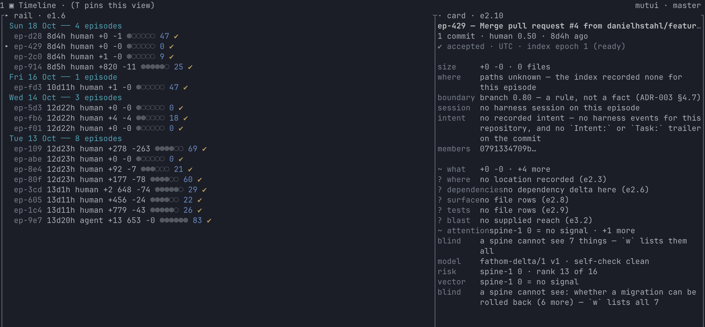

# Fathom

**A terminal UI that keeps a human's mental model of a codebase a coding agent is writing.**



The bottleneck in agentic software delivery is no longer writing code. It is the human rebuilding a
correct mental model of what the agent did. Fathom is the tool for that: it turns agent turns into
reviewable **episodes**, describes each with an evidence-backed **delta**, ranks what deserves attention
in a **queue**, keeps a durable **review ledger**, and sits in a second terminal in **ambient mode** while
the agent works. Alongside a coding harness, it is the human's confidence system for agentic software.

**→ [docs/concepts/thesis.md](docs/concepts/thesis.md)** — the product thesis, the glossary every later
ticket cites, the north-star metric (time-to-confidence) and its guardrails, and the v1 non-goals.
Everything in this repository is subordinate to that document.

**→ [docs/index.md](docs/index.md)** — the documentation site: the five-minute quickstart, the six concept
pages (**episode**, **delta**, **risk score**, **review ledger**, **ratchet**, **ambient mode**), the harness
recipes, the [detector catalogue](docs/detectors/index.md), the [CLI reference](docs/reference/cli.md), the
[keyboard cheatsheet](docs/reference/cheatsheet.md), the [feature matrix](docs/reference/features.md) and
[troubleshooting](docs/troubleshooting.md). Parts of it are generated from the code — `fathom --help`, the
keymap, `features.rs` and the blessed detector catalogue — by `python3 tools/gen_docs.py write`, and CI
fails if the committed pages disagree with the program (`python3 tools/gen_docs.py check`,
`python3 tools/check_docs_site.py`). The same tree is published as HTML on GitHub Pages by
`.github/workflows/docs.yml`, built by `python3 tools/build_docs_site.py`, whose output directory is a build
artefact and never committed ([publishing the docs as HTML](docs/reference/site.md)).

## Quickstart

Two ways in. **Install the alpha** if you want to use the thing; **build from source** if you want to
change it.

### Install the alpha

One line per operating system, from the `0.1.0-alpha.1` prerelease. Linux and macOS:

```bash
curl --proto '=https' --tlsv1.2 -LsSf \
  https://github.com/danielhstahl/fathom/releases/download/v0.1.0-alpha.1/fathom-cli-installer.sh | sh
```

Windows PowerShell:

```powershell
irm https://github.com/danielhstahl/fathom/releases/download/v0.1.0-alpha.1/fathom-cli-installer.ps1 | iex
```

Or take the artefact off the release page directly: a `.tar.xz` per platform — including a **static**
`x86_64-unknown-linux-musl` build, for the container image whose glibc somebody pinned in 2019 — an `.msi`
for Windows, `.deb` and `.rpm` packages for amd64 and arm64 Linux, and a Homebrew formula. The formula is
not published to a tap yet, and [docs/concepts/release.md §8](docs/concepts/release.md) says so plainly
instead of implying it; the same section names every signing step and the maintainer-only secret in front
of it. Nothing is signed today: each artefact has its own `.sha256`, the release has one `sha256.sum`, and
that is integrity, not authenticity.

Every archive and package carries the shell completions (bash, zsh, fish) and a man page per verb, printed
by `fathom completions` from the same definitions `--help` is rendered from: `man fathom-check` works after
a `.deb` install, and after an untar with `MANPATH` pointed at the archive.

Then `fathom --version` (prints the version and the compiled-in feature set) and `fathom doctor --json` (the
one-object report that is safe to attach to a bug report, including what your machine actually has — read it
before you send it: it contains your paths). There is no telemetry, so that object and one
[issue](docs/concepts/feedback.md) are the whole feedback loop, and
[the channel page](docs/concepts/feedback.md) says what happens to them and when: one tracker, two forms, a
weekly triage, seven dispositions, and a rule that a fixed report is named in the release notes in the
reporter's own words.

To see what it does **before pointing it at your own history**: `fathom --demo`. It unpacks a 21-commit
repository — two people and one agent, with a rename, a dependency bump, a deleted test, a CI job, a cycle
and a merge — into your cache directory, indexes it with the same `fathom index` you would run on your own
work, and opens the shell on it. No configuration is read, nothing outside
`$XDG_CACHE_HOME/fathom` is written, and deleting that directory is the complete undo
([docs/concepts/onboarding.md](docs/concepts/onboarding.md)).

The same miniature, plus five commits that seed a pathology each — churn loop, unplanned dependency, new
cycle, deleted test, reformat-only — is published as an ordinary clone, so the tour can be run against
something you `git clone`. [The scripted five-minute demo](docs/demo/five-minute.md) is the page: the tour,
the answer key, the [recorded walkthrough](docs/demo/five-minute.cast) (38 s, no sound needed), and the
three checkers that keep all of it true — `tools/five_minute_demo.py`, `tools/demo_acceptance.py` and
`tools/record_demo.py`, all three in CI.

In your own repository: `fathom index`, which now prints one progress row while it works
(`indexing 62 % · ~14 s left · 4 102 / 6 552 commits`, on a terminal, silent on a pipe), then `fathom`.

Two honest caveats, because an alpha should have none hidden: the URL above is built out of
`package.repository`, which is still the placeholder remote ADR-002 §10.3 records — until the public
remote exists at that address there is nothing behind it, and `python3 tools/check_release.py --tag
v0.1.0-alpha.1` is the pre-flight that says so before anyone pushes a tag. And this is an **alpha**: the
git spine (index, episodes, timeline, diff, queue, session) is usable for a daily review; the ranked
delta-carrying review frame is Epic 2's, the architecture graph is Epic 3's, and there is no export yet.
[docs/concepts/release.md](docs/concepts/release.md) is the release document — what an artefact set is,
how to cut the next alpha, and what adoption looks like without telemetry. Each release also carries a
generated [SBOM and licence report](docs/concepts/privacy.md#6-what-a-release-publishes), and
the default binary makes no outbound call unless you turned a named feature on
([privacy](docs/concepts/privacy.md)).

### Build from source

Five lines, from a clean clone, on Linux, macOS or Windows:

```bash
git clone <this repo> && cd fathom            # 1. the workspace is the repo
cargo build -p fathom-cli                     # 2. default features are the shipped product (§6.1)
./target/debug/fathom --version               # 3. prints the version *and* the resolved feature set
./target/debug/fathom doctor --privacy        # 4. what is compiled in, and what would need consent
cargo test --workspace                        # 5. the contract tests, boundary lint included
```

Step 4 is the privacy posture of *your* build, printed by the binary rather than promised by a README:
[docs/concepts/privacy.md](docs/concepts/privacy.md) is the page, `python3 tools/check_privacy.py` is the
check that keeps it true, and a CI job runs the shipped binary with no network available at all
([`.github/workflows/privacy.yml`](.github/workflows/privacy.yml)). A default build contains no HTTP
client, no TLS stack and no git transport — you can verify that about a binary instead of trusting this
sentence, which is the whole point of the `net-*` naming rule.

`cargo build --workspace` and `cargo test --workspace` are expected to succeed on a clean clone with
nothing installed but a Rust toolchain (the pinned one is in `rust-toolchain.toml`); that promise is
`e0.7`'s acceptance criterion and CI runs it on three operating systems. The binary answers today;
not every verb is implemented yet, and each unimplemented one says which ticket owns it.

## Status

**Alpha.** The product is no longer pre-implementation: `0.1.0-alpha.1` is the version `fathom --version`
prints, the git spine is built and reviewed against a 500-commit agent-driven repository, and the release
path that would publish it is gated by `tools/check_release.py`. What is not done is the publishing and
the people: no tag has been pushed, so no artefact exists on any operating system yet, and nobody outside
the core team is using it weekly. `m0` (`reco-n1j`) is the milestone, and its close reason is the record
of which half is code and which half is not.

| Area | Where | State |
|---|---|---|
| Product thesis, glossary, metrics, non-goals | [docs/concepts/thesis.md](docs/concepts/thesis.md) | accepted (ADR-001) |
| The documentation site: quickstart, the six concept pages, harness recipes, the detector catalogue, CLI reference, cheatsheet, feature matrix, troubleshooting | [docs/index.md](docs/index.md) | `e7.5` (`reco-60m`). The CLI, cheatsheet, detector-example and feature pages are generated from the program (`python3 tools/gen_docs.py check`), and `python3 tools/check_docs_site.py` fails an orphan page, a dangling anchor, a placeholder left in prose, or a shipped verb, build feature, TUI view or detector with no documentation entry |
| Architecture decision records | [docs/adr/](docs/adr/) | all six accepted: ADR-001, [ADR-002](docs/adr/0002-workspace.md), [ADR-003](docs/adr/0003-episodes.md), [ADR-004](docs/adr/0004-storage.md), [ADR-005](docs/adr/0005-harness-contract.md), [ADR-006](docs/adr/0006-tui.md) |
| Episode identity and segmentation (what a review is keyed to, and what survives a rebase) | [docs/adr/0003-episodes.md](docs/adr/0003-episodes.md), `crates/fathom-ingest/src/segment.rs`, `src/recommender/segment.py` | accepted; the digests, the boundary cascade and the relink tiers are asserted by `tests/test_episode_identity_contract.py` |
| Storage, indexing and cache contract (schema, invalidation matrix, perf budgets) | [docs/adr/0004-storage.md](docs/adr/0004-storage.md), `src/recommender/store/`, [benchmarks/budgets.json](benchmarks/budgets.json) | accepted; `e0.11` gates CI on `benchmarks/budgets.json` |
| Perf budget gate: the 172 numbers of ADR-004 §11 as a red build, with cold index, warm re-index, diff-open, query p95 and peak RSS measured on the fixture corpus | [benchmarks/BUDGETS.md](benchmarks/BUDGETS.md), `tools/perf_gate.py`, `crates/fathom-store/benches/budgets.rs`, [benchmarks/baselines/perf-gate.json](benchmarks/baselines/perf-gate.json), `.github/workflows/perf.yml` | `e0.11` (`reco-pef`) built: `make bench` reproduces every number in under 30 s locally (fixture build, criterion benches, runner calibration and 3 pty probes included); the gate checks each measurement twice — against its budget, and against the blessed baseline — and fails past `regression_fail_pct` (15 %) in **either** direction, so an un-blessed improvement is also red. A runner factor from ADR-004 §11.8's calibration bench scales wall clocks and never touches RSS or store bytes; `--inject-ms 400` proves the gate goes red (and `--self-test` proves it with no build at all), `reco-7tc`'s no-op re-index is on the breach register with a ceiling rather than quietly waived, and the trend is a job artefact, not a committed file |
| Graph-per-revision storage policy: what a revision's architecture graph costs at 10 000 commits, and which representation `e3.2` may build | [docs/concepts/graph-storage.md](docs/concepts/graph-storage.md), `src/recommender/store/graphsnap.py`, `src/recommender/store/graphbench.py`, [benchmarks/reports/s3-graph-snapshots.json](benchmarks/reports/s3-graph-snapshots.json) | spike `s3` (`reco-279`) measured, closing ADR-004 §14.1: five strategies written into §4.6's real DDL and run over a 10 004-commit repository (2 298 modules, 54 025 graph rows). Chosen — a delta per revision plus a shared anchor every `graph.chain_full_every = 32`, on the blob-keyed per-file substrate: **22 335 B/revision** against a 32 KiB budget, a 0.381 ms warm cursor step. Refused — a full snapshot per revision (**16.7 MB/revision**, 681×) and content-defined chunking (1.09 MB/revision, because the membership list is the cost); structural sharing measured affordable at 19 KiB but refused on read cost. The floor that survived is materialising one revision: 70.9 ms p50 / 204.6 ms p95, now budgeted as `graph.materialise_revision.ms`. Asserted by `tests/test_graph_spike_contract.py`; tables generated by `tools/gen_graph_tables.py` |
| Structural extraction accuracy: what tree-sitter can and cannot tell `e3.1` about six languages, and which grammars ship | [docs/concepts/structure-extraction.md](docs/concepts/structure-extraction.md), `crates/fathom-analyze/examples/s1_spike.rs`, `crates/fathom-analyze/spike/s1/`, [benchmarks/reports/s1-tree-sitter-accuracy.json](benchmarks/reports/s1-tree-sitter-accuracy.json) | spike `s1` (`reco-alj`) measured, closing ADR-002 §6.5's open question: six throwaway extractors scored row-by-row against a hand-annotated corpus (373 definitions, 149 exports, 103 resolved import edges). All six grammars ship — none is a dealbreaker — with definition recall 94.0–100 % and import-edge recall 100 % everywhere. Four carry conditions, and they all carry the same one: declarations a *program* wrote (Rust macros, Python decorators, Java record accessors, Ruby `define_method` over a collection) are not in the tree and no extractor can put them there, so `e3.1` must model "cannot enumerate" instead of quietly reporting absence. Ruby is the one real cost finding — under 1 MiB/s parse against 11–16 MiB/s for the others — and Ruby's export surface is degenerate (8 exports for 67 declarations), which moves `e3.7`'s Ruby surface question to the file. Asserted by `tests/test_structure_spike_contract.py`; tables generated by `tools/gen_structure_tables.py` |
| Structural extraction, shipped: what the extractor gets right on Rust, Python and TypeScript, and exactly what it is not allowed to claim | [docs/concepts/structure-extraction.md](docs/concepts/structure-extraction.md), `crates/fathom-analyze/src/structure/`, `crates/fathom-analyze/examples/structure_harness.rs`, `crates/fathom-analyze/structure/`, [benchmarks/reports/e3-1-structure-core.json](benchmarks/reports/e3-1-structure-core.json) | `e3.1` (`reco-zoz`) built, on spike `s1`'s instructions: definitions with span and complexity proxy, export visibility, imports with resolved targets, implemented traits and inherited bases, and the two states the spike argued for. `synthetic_eligible` is a state with reasons (`macro_definition`, `decorated`, `monkeypatch`, `synthesised_accessors`, `wildcard_reexport`, `ambient_merge`) and the only permitted sentence about it — *may have shrunk, not shrunk*; a star import is `EdgeKind::Wildcard`, never a named symbol, and `dependents_of` answers who-depends-on as *named* plus *unknown contents*, never *nobody*; resolution is a bounded iteration whose bound is a config key (`extract.resolution.max_passes`) and whose per-file `converged` is reported, with the corpus re-run at a bound of one inside the report so the bound is seen biting; every input file returns a record, and one with no structure returns a reason plus its file-level measurement. Measured on the inherited corpus (26 files, 4 relationships): P 1.000 / R 1.000 on definitions, exports, imports and supertypes in all three languages, 12/12 synthetic scopes, 8/8 wildcard edges, 1 572–3 744 files/s/core against a 1 000 floor, and byte-identical canonical output pinned by a golden the harness's own snapshot reproduces. All three verdicts are `conditions`, each with a named cause (macro-written items, `@dataclass` and monkeypatched methods, bundler-written modules), and an excuse costs the extractor a synthetic scope — the truth file may only excuse a row in a file that also demands the state. Asserted by `tests/test_structure_core_contract.py` and `crates/fathom-analyze/tests/structure_core.rs`; CI re-measures it with `--check`. **`e3.1b` (`reco-dlp.1`) took it to six languages**: Go, where a resolved import is package-granular and every such edge carries the granularity and the import path it came from (a file-level Go graph says `main.go → shape/circle.go` where the language says `main → shape`, and only one of those is a dependency anyone can reason about); Ruby, where the scan is bounded per run by configuration (`extract.ruby.max_files_per_run`, `…max_bytes_per_run`, `…priority`), a refused file is still a measured file, and the export surface is labelled degenerate because the honest question is what an entry point loads; and Java, where same-package resolution is scoped to the declared package and re-measured at repository scale — 2 760 edges with 0.000 false positives against a stated ≤ 2 % budget, where the spike's wide scan claims 108 356 edges at 97.5 %. Asserted by `tests/test_structure_tail_contract.py` and `crates/fathom-analyze/tests/structure_tail.rs`
| The per-revision architecture graph: the nodes and the seven edge kinds, the five questions it answers, and the four claims it is not allowed to make | [docs/concepts/architecture-graph.md](docs/concepts/architecture-graph.md), `crates/fathom-analyze/src/graph/`, `crates/fathom-store/src/graph.rs`, [benchmarks/reports/e3-2-graph-chain.json](benchmarks/reports/e3-2-graph-chain.json) | `e3.2` (`reco-8s4`) built the storage policy spike `s3` chose: one graph delta per revision plus a shared content-addressed anchor every `graph.chain_full_every = 32`, on top of `e1.4`'s blob-keyed per-file substrate, with node ids interned in a `graph_node` dictionary — the reduction `s3` measured and did not spend. Measured on the shipped lane at `s3`'s repository shape (2 300 modules, 1 000 revisions): **6 041 B/revision** against a 32 KiB budget, where the prototype with ids not interned cost 22 335 B; materialise 20.61 ms p50 / 23.33 ms p95 against 64 ms, a one-commit cursor step 10.09 ms p50, dependents 0.014 ms p50 against 20 ms, adjacent changed-edges 0.020 ms p50 against 15 ms; the longest chain walk the history needed was 31 steps against `graph.query.max_chain_walk = 32`, and a chain that reaches the cap is a stated partial rather than a small graph passed off as the revision. Wildcard, package-granular and possibly-shrunk dependencies are separate edge kinds and separate buckets in every answer, so a caller list cannot read as complete when it may not be. Asserted by `crates/fathom-analyze/tests/graph.rs` and `crates/fathom-analyze/tests/graph_lane.rs`, measured by `cargo run --release -p fathom-analyze --features sqlite-bundled --example graph_harness` |
| Episode segmentation accuracy: does ADR-003's boundary cascade find the boundaries a reviewer would draw, and what does a wrong one hide | [docs/concepts/episode-segmentation.md](docs/concepts/episode-segmentation.md), `crates/fathom-fixtures/corpus/turns/`, `crates/fathom-analyze/examples/s2_spike.rs`, `crates/fathom-analyze/spike/s2/`, [benchmarks/reports/s2-segmentation-accuracy.json](benchmarks/reports/s2-segmentation-accuracy.json) | spike `s2` (`reco-q6r`) measured, closing ADR-003 §4.4 and §13.7: 204 hand-annotated turns over 264 commits (32 real, from this repository's own git history and its beads board; 81 carried from `e0.10`; 91 authored), scored as boundary positions with pair co-membership and a pathologies-hidden column beside F1. The shipped cascade is precise (0.938) and short of recall (0.747): 0.832 pooled F1, 0.897 on real history, and 0.431 pair F1 against `e1.3`'s published ≥ 0.90. Split-everything beats it on F1 and hides 23 of 74 pathologies doing it. The three named candidates: 0.722 time+author, 0.855 hook with harness evidence (0.338 with what ships: no real commit carries turn evidence), 0.092 trailers+message-shape (rung 3's trailer has no writers). Decisions: `episode.time_gap_minutes` **stays 30** (pooled optimum 10, worth +0.022, and flat within ±0.02 once a subject-ticket-token rule exists), a `subject-claim` rung goes above the clock (+0.087 pooled / +0.034 real F1, pathologies hidden 8 → 5, zero false boundaries), `turn_id` must be session-qualified, TB7 is confirmed weakest and kept. Asserted by `tests/test_segmentation_spike_contract.py`; tables generated by `tools/gen_segment_tables.py` |
| Episode re-linking: when history is rewritten, does a reviewer's decision follow the change it was given to, does it ever follow the wrong change, and what would a fuzzy match cost | [docs/concepts/episode-relink.md](docs/concepts/episode-relink.md), `crates/fathom-fixtures/corpus/relinks/`, `crates/fathom-analyze/examples/s6_spike.rs`, `crates/fathom-analyze/spike/s6/`, [benchmarks/reports/s6-relink-accuracy.json](benchmarks/reports/s6-relink-accuracy.json) | spike `s6` (`reco-f5a`) measured the half of ADR-003 §13.1 that `s2` left: **21 rewrite families over 1562 rewrite events** laid on `s2`'s annotated histories, truth written as carried pairs, the spike's own copy of the ladder pinned link-for-link against `fathom_store`'s relink pass on every event. The shipped §6.2 ladder loses **445 of 1232** annotated carries (36 %) and only **19** are its own fault: **393 (32 %) are beyond any digest** — including `--amend --reset-author`, which §6.3 does not name — tier 3 buys **1** carry and tier 2 is the leaky rung (**8.4 %** false against tier 1's 2.0 %), and the same pass writes **5.2 % false rows on a fully dispositioned queue and 41 % on one a third unread**, because RL0 means a false relink can only land on an episode nobody has read yet. A subject-similarity tier buys 200 floor carries for 4 false relinks on the first board and 57 for 70 on the second, against a price of better than 3:1: **§13.1 is closed NO-GO**, §6.3's floor goes to `method='manual'` instead, and RL4 is to be tightened. Asserted by `tests/test_relink_spike_contract.py`; tables generated by `tools/gen_relink_tables.py` |
| Rename and copy detection: how often a pairing method asserts something untrue, and at what confidence a pairing is safe to show as a fact | [docs/concepts/rename-detection.md](docs/concepts/rename-detection.md), `src/recommender/rename/`, [benchmarks/reports/s4-rename-detection.json](benchmarks/reports/s4-rename-detection.json) | spike `s4` (`reco-gj6`) measured, replacing `e2.4`'s guessed "≥ 90 % pair precision and recall": 16 authored repositories built by real `git` (29 review windows, 49 commits, 4 merges, a squash rebase and an evil merge made with `commit-tree`), 60 hand-authored true pairings, 5 **named decoys** and 5 pairs past a stated evidence ceiling, 23 detector configurations swept from 0.10 to 0.90, 51 gates, re-measured in CI. The finding is that **a similarity score cannot be the fact boundary**: the corpus's scaffolded false pair scores R064 in git at its shipped default and J≈0.49 in the matcher, *above* the true rewritten move at R015 / J≈0.06, so every bar low enough to catch a real rewrite is high enough to ship the lie. Fact tier — git at **0.75** (not the shipped 50 %, which asserts a named decoy): precision **1.00** on 34 pairings, recall **0.618** of claimable, **0** wrong; the cheapest band worth showing buys **+17 true pairings for +1 lie**, which is a display problem and not a threshold. Three things the plan gets changed by: do **not** blend path similarity into the score (a 0.15 weight takes wrong pairings from **1** to **36** at the same bar), report splits/folds/copies as a group and never as a rename pair (found **0** times at the fact bar by every method, by shape not by tuning), and quote recall per representation class. `MinHash`'s own price is measured too: 545 sketch-vs-exact pairs, p95 error 0.063, and 29 of them land on opposite sides of a 0.3 bar. Asserted by `tests/test_rename_spike_contract.py`; tables generated by `tools/gen_rename_tables.py` |
| Rename and copy **pairing**: what the card asserts, what it only guesses, and what a reviewer's accept or reject does | [docs/concepts/rename-pairing.md](docs/concepts/rename-pairing.md), `src/recommender/rename/`, [benchmarks/reports/e2-4-rename-pairing.json](benchmarks/reports/e2-4-rename-pairing.json) | `e2.4` (`reco-a0v`) built, on spike `s4`'s measurement: pairings are **groupings with a shape**, so a 1→3 split is one pairing with three destinations and a fold keeps its modified destination instead of looking like two renames; a pairing is a **fact** only when git's own rewriter reports it at or above `rename.fact_bar`, shipped at the measured **0.75** rather than git's 50 %, because at 50 % git asserts a scaffolded decoy — a fact has to be checkable with `git log --follow`, which is the whole test of the word. Measured on 17 fixtures built by real `git` (37 windows, 67 hand-authored pairs, 62 claimable, decoys and evidence ceilings kept): fact tier **40 pairings, 0 untrue**, precision **1.0**, recall **0.6452**; pooled **0.9836 / 0.9677**, **2.7 untrue per 100 windows**, and the two fixtures the ticket names paired **in full with 0 untrue**; recall by class because pooling hides it — rename 48/48, split 9/9, fold 3/3, copy **0/2 shipped** and 2/2 only in the opt-in widened mode. Everything else is a **labelled guess** the reviewer can `accept` or `reject`; decisions live in `.fathom/rename-review.json`, are bound to the **bytes** they were made about so a rewritten history re-opens them instead of inheriting them, and a reject stays counted rather than vanishing. Cost measured rather than claimed: repository 200→4000 paths with the change set fixed costs **2.69×** (gate 3.0) while the refused `O(repo)` mode costs **15.56×** and reads 4000 blobs to shipped's 6; the quiet-window fixtures emit **nothing**. Two prohibitions became gates: path similarity is never part of a score (printed, used to order, never scored — a 0.15 name weight once took wrong pairings from 1 to 36), and no content score is an approximation (exact Jaccard, recomputed by a gate). 13 config keys, `diff.rename_detect` at version 2, 30 CI gates via `fathom rename score --check`, tables generated by `tools/gen_rename_pairing_tables.py`, asserted by `tests/test_rename_pairing_contract.py` |
| Harness integration contract (hooks v1, events, MCP surface) | [docs/adr/0005-harness-contract.md](docs/adr/0005-harness-contract.md) | accepted; contract fixtures in `src/recommender/harness/`, `src/recommender/hooks/` |

| Configuration: `fathom.toml`, five layers, schema, `config explain` | [docs/concepts/config.md](docs/concepts/config.md), `src/recommender/config/`, [schemas/fathom.schema.json](schemas/fathom.schema.json), `fathom.toml` | `e0.8` (`reco-dq3`) built: the schema and the key reference are generated and CI diffs them; this repo's own `fathom.toml` is validated in CI |
| Path taxonomy and noise policy: what a path *is*, how noisy it is, which rule said so | [docs/concepts/paths.md](docs/concepts/paths.md), `src/recommender/taxonomy/`, `fathom.toml` | `e0.9` (`reco-5vz`) built: a 235-path decision table over 24 repo shapes, `fathom taxonomy explain <path>` prints the rule, its layer and the runners-up, and the storage fixture no longer keeps its own glob list |
| Change classifier: per-episode file taxonomy — path rules plus content evidence, with confidence and a reason | [docs/concepts/change-classification.md](docs/concepts/change-classification.md), `src/recommender/change/` | `e2.1` (`reco-dsh`) built: 37 content markers plus parsed-content and build-config evidence over the `e0.9` table, `fathom change explain <path>` for the receipts, a 207-path labelled corpus scored in CI (`fathom change score`), and classifications cached per blob |
| Folder structure delta and directory-level summary: where this episode's code landed, what shape the move made, and whether the tree itself moved | [docs/concepts/folder-structure.md](docs/concepts/folder-structure.md), `src/recommender/structure/` | `e2.3` (`reco-5fn`) built: a per-directory table of added / removed / **moved** lines and files created / deleted / moved that is checked column-by-column against the episode totals on every fixture and on 400 generated episodes, the four shapes the review question is asked in (`package-rename`, `subtree-move`, `module-split`, `directory-flatten`) defined by 26 tunable numbers instead of a hunch, tree metrics before and after (depth, fanout, files per directory, share of code in the top-3 directories) with the **basis** of the census printed because "this folder has 14 files" means two different things, a bounded structure-churn score whose five components are printed beside it — which is how "the agent reorganised the tree" becomes a number a reviewer can argue with, separating a 20-file local change (0.000) from a 20-file cross-tree reshuffle (0.900) — and one deterministic sentence per episode with evidence behind every clause, byte-identical across objects, calls and processes. Pairings come from the change list, from `e2.4`, or from a labelled guess: what git asserted is a fact, what this package inferred is a guess at any similarity, and a shape built on a guess is an inferred story. Scored in CI on 7 shape / 8 trap / 12 episode labels with shape, summary, precision, episode and reconciliation accuracy all barred at 1.0, asserted by `tests/test_structure_delta_contract.py`, audited by `render.audit` on the CLI's own output, 37 config keys declared in `e0.8`'s schema |
| Noise suppression: reformat, generated churn and lockfile-only change, folded with the reason printed | [docs/concepts/noise-suppression.md](docs/concepts/noise-suppression.md), `src/recommender/noise/` | `e2.2` (`reco-zqf`) built: a per-language token-normalised pair comparison (24 languages; `rustfmt`/`prettier`/`gofmt`/`black` re-layouts fold, a real change wearing whitespace does not), generated-churn kinds with floors that keep a hand patch inside a generated file visible, 13 lockfile formats counted instead of diffed, `noise.suppress.*` policy keys that layer and print the layer that won, and a fold that cannot render without its key, its policy, its reason and its evidence — asserted by a blessed render and by an auditor that is itself tested against a render that hides |
| Dependency surface: what a revision declares and resolved, per package, across eight ecosystems — with every unreadable file still reviewable | [docs/concepts/dependency-surface.md](docs/concepts/dependency-surface.md), `crates/fathom-analyze/src/deps/` | `e2.5` (`reco-j83`) built: 25 formats (`package.json` + npm/yarn/pnpm locks, `Cargo.toml`/`Cargo.lock`, `pyproject.toml` + requirements/poetry/uv/Pipfile locks, `go.mod`/`go.sum`/`go.work`, `Gemfile`/`Gemfile.lock`, `mix.exs`/`mix.lock`, `pom.xml`/Gradle/`gradle.lockfile`, `*.csproj`/`Directory.Packages.props`/`packages.lock.json`), per-member workspaces with glob-claim reporting, eight typed `unparsed` reasons each carrying a raw-text preview, one `deps-*` feature per ecosystem, and an 8 MiB monorepo scan benched at ~90 ms in release |
| Dependency delta: what an episode did to the resolved graph — direct vs transitive, added, removed, upgraded, downgraded, re-sourced, with the hunk that proves each row | [docs/concepts/dependency-delta.md](docs/concepts/dependency-delta.md), `crates/fathom-analyze/src/deps/{state,diff,hunk,version,render}.rs` | `e2.6` (`reco-kvs`) built: two-revision graph diff over eight ecosystems and 10 golden before/after fixtures, per-change attribution with its evidence (lockfile statement, manifest, resolved edge) and explicit `unknown` where a lockfile records no edges, bump-storm detection that separates a mass transitive refresh from the one direct change beside it, source/integrity/licence/peer-conflict rows, a line-level hunk locator, and a rendered per-episode table with drill-down |
| Dependency risk: who asked for this dependency, and should I be worried — provenance, cached advisories and licence policy | [docs/concepts/dependency-risk.md](docs/concepts/dependency-risk.md), `src/recommender/deprisk/` | `e2.7` (`reco-yxi`) built: a **provenance ladder** that answers `introduced by episode X, intent: Y` from this episode, else from a recorded earlier introduction, else prints `not recorded` with the two things that would fill it — and that refuses to invent a rung, so a `prompt_sha256` is reported as a partial (hooks v1 stores no prompt text, ADR-005 §2.2) and `agent codex` is never an answer to *who asked* by default; advisory lookup behind **three gates that must all agree** (`deps.advisories.enabled`, `mode = "refresh"`, user-scoped `privacy.advisories`) to an endpoint fixed in code with no config key to redirect it, so the default build makes **zero network calls** — asserted by tests that trap `socket.socket` and then run every verb, and by `consent` printing `0 network call(s)`; a cache with **five freshness states** where an expired one changes tense to `not checked recently` instead of claiming `no advisories found`, where an unchecked or query-failed package is never counted clean, and where no cache, a corrupt cache or `offline` still renders the card; a **licence matrix** — copyleft class × (library layer / everywhere else), every class table and every cell in `fathom.toml`, `OR` branches resolved and the options not taken printed, drift caught when the version did not move, an undeclared licence a stated partial and never a pass, and every violation carrying the **offending edge path** (`fathom-analyze → jwt 2.1.0 → ring`), which is the half a reviewer can act on. 49 config keys declared in `e0.8`'s schema, 28 hand-authored cases with recorded OSV payloads scored in CI with provenance, intent, licence precision, licence recall, advisory recall, freshness, finding-table and reconciliation accuracy all barred at 1.0, 200 generated episodes reconciling, the analysis half checked by AST for no `socket`, `urllib`, `os`, `pathlib`, `time` or `datetime`, and `render.audit` run on the CLI's own output | 
| Test surface delta and coverage proxy: the testing contract per episode, in test names and locations instead of a coverage percentage | [docs/concepts/test-surface.md](docs/concepts/test-surface.md), `src/recommender/testsurface/` | `e2.9` (`reco-6pl`) built: test lines and production lines attributed **per line** (so a Rust `#[cfg(test)] mod` inside a source file counts as test, not as production) and a ratio that is never printed without both absolutes or without its denominator named; named cases parsed for Rust, Python, TypeScript, Go and Java, so a deleted, skipped, un-skipped, focused or assertion-weakened test is a finding with the case name and its `path:line` — an unanchored finding raises rather than going vague; "new public logic, no new test" defined by 20 config keys, not a hunch, with the coverage decision printed per symbol including the times it stayed silent; and no framework degrading to a line-count proxy that states its 0.3 confidence instead of reporting zero tests. Scored in CI on 12 parse / 10 pair / 20 coverage / 6 episode labels with precision and recall both barred at 1.0, asserted by `tests/test_test_surface_contract.py`, audited by `render.audit` on the CLI's own output |
| Non-code surface changes: config, env, flags, migrations and CI — the operator-action checklist per episode | [docs/concepts/noncode-surfaces.md](docs/concepts/noncode-surfaces.md), `src/recommender/noncode/` | `e2.8` (`reco-bjd`) built: six surfaces (env, flag, migration, CI, IaC, container) and 27 finding kinds, each with its own switch, severity, owner and verb; environment variables **cross-checked** between declarations and references in eight languages, so a variable added in `.env.example` and never read is as loud as one removed while `src/settings.py` still reads it, and a half-done rename is one row instead of two harmless-looking ones; migrations classified by dialect with reversibility, forward-path-only destructiveness and an explicit `needs deploy coordination` warning for a migration-only episode; CI secrets, permission escalations, new external identities, runner moves and new push-to-`main` triggers; infrastructure deltas by resource address; base-image moves that say which part moved; every finding rolled into a per-episode `requires operator action` checklist with an owner on every row, duplicates merged, the cap naming its remainder, and an auditor that fails a card which lost a checkbox. Scored in CI on 37 rule fixtures / 12 traps / 5 episodes with precision and rule accuracy both barred at 1.0 and all six surfaces required, asserted by `tests/test_noncode_contract.py`, 45 config keys declared in `e0.8`'s schema |
| Diff viewer: file tree grouped by taxonomy with per-file counts and read/dirty markers, unified and split hunks with highlighting, word-diff and whitespace-ignore, hunk motion, copy path / copy hunk / `$EDITOR`, and what each degenerate case says | [docs/concepts/diff-viewer.md](docs/concepts/diff-viewer.md), `crates/fathom-tui/src/diff/` | `reconcile` (`reco-0q7`) built: patch bytes through one `PatchSource` trait with positioned chunked reads and a documented `Budget` (the index is O(files + hunks), not O(lines)), one planner shared by the scan and the renderer so hunk anchors and drawing cannot drift, 18 golden fixtures including binary, mode-only, deleted, renamed-with-edits, oversize, CRLF churn and offline diffs — each of which says what is missing and the command that fixes it |
| Timeline view: the episode rail — six columns and the fixed order they drop in, day/session grouping with counted collapse, composable filters (author, kind, state, area, date range) persisted in session state, jumps (first unread, today), and a card that cites delta fields it cannot fill yet | [docs/concepts/timeline.md](docs/concepts/timeline.md), `crates/fathom-tui/src/timeline/` | `e1.6` (`reco-bjo`) built: rows arrive as a `Batch`, never a store handle (ADR-002 §3), the draw builds the window and not the index (10 000 episodes, p99 scroll under 16 ms, per-frame bytes measured against a 500-row rail), selection follows episode identity through all four ADR-003 relink tiers, and every empty, filtered and collapsed state is a sentence with the verb that fixes it |
| Risk ranking: the order the queue is in — `spine-1`, five capped components that add to the printed number, a reason per row that names a file the reviewer can open, and the seven things the model cannot see | [docs/concepts/risk-ranking.md](docs/concepts/risk-ranking.md), `crates/fathom-analyze/src/risk.rs`, `crates/fathom-tui/src/worklist.rs` | built from the spine alone, which is why the number comes with its own blind spots printed beside it: the queue answers \"which three episodes are the riskiest?\" on the first screen, because the kind of file outranks the amount of file (a three-line CI edit and the migration that drops a column are first, a 400-line documentation edit is not), `w` prints the selected episode's vector, its rank and what the model could not see, and an episode nothing ranked prints `?` and sorts last — never a `0` standing in for \"nobody looked\`. `e4.4` replaces its inputs and `e4.5` its ordering function. Asserted on the 500-commit fixture by `tests/test_risk_ranking_contract.py` and `crates/fathom-cli/tests/risk_rank.rs` |
| Risk scoring: `features-1` — twelve documented axes (findings and severities, surface, migration, blast, test ratio, size, dependency, deletions, noise, breadth, attribution confidence, authorship), clamped per-repo weights in `fathom.toml`, and a 40-case calibration set that turns a weight change from a feeling into a number | [docs/concepts/risk-scoring.md](docs/concepts/risk-scoring.md), `crates/fathom-analyze/src/risk/`, `crates/fathom-cli/src/why.rs` | `fathom why <episode>` prints the score as a sum: every feature, its weight, its contribution, the reason behind each, the axes it could not measure (with the ticket that owns each), and what the model cannot see at all; an absent axis leaves the denominator instead of posing as a zero, identical input prints identical bytes, and `fathom why --calibrate` reports precision/recall of the top decile before and after a retune (0.750/0.500 → 1.000/0.667 on the shipped corpus) |
| Guardrail 3 calibration: the false-positive harness — three real OSS repositories pinned by commit, hand-authored dispositions in `e4.6`'s closed vocabulary, and `G3` attributed per detector | [docs/concepts/false-positive-calibration.md](docs/concepts/false-positive-calibration.md), `crates/fathom-analyze/examples/g3_calibration.rs`, `crates/fathom-analyze/calibration/g3/`, `tools/fetch_g3_corpus.py` | `e4.9` (`reco-mkl.1`) built the thing `e4.3` and `m1` were told to defer to: 180 episodes of `cli/cli`, `pallets/flask` and `astral-sh/ruff` pinned by oid, scored by the shipped `risk::score` at the shipped `risk.tau` (checked against it, so one number), all 22 flagged episodes labelled against the diff with the file and line each verdict came from, and `cargo run -p fathom-analyze --features sqlite-bundled --example g3_calibration -- --check` in CI re-measures the blessed report byte for byte with every gate required to come out as its declared `expected`. Measured: `G3` **0.682** against the `0.30` bar across everything the corpus flagged (11 `low-stakes` bot and maintenance bumps, 3 `false-positive`, 1 `intentional`; 7 of 15 blamed on the ranking, not a detector), a miss rate of **1.000** at τ 70 because all 7 reworked mature episodes scored under it, and `G3` itself **not measurable** at the published default with 3 flags in 180 episodes — so no shipped default was flipped in either direction, and the four detectors `e4.3` shipped disabled stay disabled. Asserted by `tests/test_g3_calibration_contract.py`, which also fails any source line that names `truth.json` and carries a write primitive: the harness may not author its own truth |
| Episode narrative: the prose a human skims per episode, with a citation on every claim and a template watermark that says no model wrote it | [docs/concepts/episode-narrative.md](docs/concepts/episode-narrative.md), `crates/fathom-analyze/src/narrative.rs`, `crates/fathom-analyze/src/narrative/`, `crates/fathom-cli/src/narrative.rs` | `e4.7` (`reco-2rx`) built what spike `s5` decided rather than what it hoped: `fathom narrative <episode>` composes the delta document into paragraphs, prices every claim, lifts the expensive ones into *Read this first* and rewrites every blind spot as **You cannot tell …** — the three readability defects `s5` measured at 2.23/5, fixed in the template that produced them. No claim without evidence: a self-audit re-resolves every pointer inside the delta document it was composed from, checks every number a sentence prints appears in the text of the citations that sentence carries, and prints its verdict as the last line (`fathom-template/1 verified: 29 claims, 31 citations, 6 checks`); four tamperings prove the auditor is awake. The LLM polish path is **not shipped** — `reco-nv0` measured it and said no — so the decision is a queryable fact instead of a paragraph: `narrative::llm::{SHIPPED, GATES}` plus a scanner that walks this crate's own source and fails the build if a `net-llm` consumer or an HTTP client ever appears, printed by `fathom narrative --attribution`. Byte-deterministic, and the export body is literally the same call (`export::narrative_markdown`). Asserted by `crates/fathom-analyze/tests/narrative.rs` (14 tests, golden file included) and `crates/fathom-cli/tests/cli_narrative.rs` (7 end to end) |
| Review artefact: one record rendered as markdown, HTML and JSON for a pull request or an audit — byte-identical when re-exported, hostile commit messages escaped, sign-offs with their reasons | [docs/concepts/export-artefact.md](docs/concepts/export-artefact.md), `crates/fathom-analyze/src/export/`, `crates/fathom-cli/src/export.rs`, [schemas/export.schema.json](schemas/export.schema.json) | `e5.7` (`reco-1tn`) built: one `Record` composed by `export::build` from the delta documents, the ledger and the detector report — no store, no clock, no config in the way it is built, so **the same range gives the same bytes twice** (the acceptance criterion, and the reason the record prints only instants the repository or the ledger already held); three renderings of that one structure, so the markdown a reviewer pastes into a PR, the HTML they attach to an audit and the JSON an agent parses cannot disagree — with a self-check (`Record::verify`) that every finding and sign-off belongs to an episode in scope, that each narrative is the composer's own bytes, and that no absolute path or control byte leaked; markdown escaping that survives a commit subject carrying a pipe, a backtick and a `javascript:` link, and one self-contained printable HTML file with a CSP that runs and fetches nothing; a sign-off block with reviewer, instant, scope, digests, and the **reason behind every dismissal**; the operator-action checklist with the command that closes each item, and `--strict` exiting `7` while an item is open. Asserted by `crates/fathom-analyze/tests/export.rs` and `crates/fathom-cli/tests/export_verb.rs` |
| Plan versus execution: the six contradictions between what a session's recorded intent said and what its episodes did, both sides linked | [docs/concepts/plan-drift.md](docs/concepts/plan-drift.md), `crates/fathom-analyze/src/drift.rs`, `crates/fathom-analyze/src/drift/detect.rs`, `crates/fathom-cli/src/drift.rs` | `e4.8` (`reco-cpr`) built `fathom drift`: planned-never-done, tests promised and never written, refactor claimed on an untouched surface, edits outside the declared scope, a dependency manifest nobody announced, and a plan item that re-opens work a human already **signed off** (`e4.6`'s ledger is the durable side of that argument). Every finding is a *pair* — the plan text quoted with the address that holds it, and the diff/glob/ledger row that contradicts it — priced by the intent rung that stated it (`0.83 via agent-intent-trailer` is not the same sentence as a hook prompt), bounded by a look-ahead window and caps that say when they bit, and dismissible by a key built from the rule and the item so a dismissal survives the rewrite that would eat a finding. What cannot be judged is listed with its owner instead of guessed at: no intent, no scope glob, an unparseable glob, an unreadable test surface — "I cannot tell whether a test was touched" never becomes "no test was written". Asserted by `crates/fathom-analyze/tests/drift.rs` (23 tests, one fixture per kind, plus a source scan proving the module reads nothing but its input) and `crates/fathom-cli/tests/cli_drift.rs` (7 end to end, including a dismissal carried from one run's output into the next run's flag) |
| Episode summary card: the one screen per episode — what changed, where it landed, what it can now reach, what non-code surface moved, whether the tests moved with the code, who it could break and what to read first, every figure linked to the view that proves it | [docs/concepts/summary-card.md](docs/concepts/summary-card.md), `src/recommender/card/` | `e2.10` (`reco-4ey`) built: seven sections in a fixed order, six of them relaying analyses that already exist (`e2.2`, `e2.1`, `e2.3`, `e2.6`, `e2.8`, `e2.9`, `e4.4`) and one that nothing else produces — who this could break, from `e3.2` when a caller supplies reach and from a clearly-labelled path heuristic when nobody did, with the basis and the hop limit printed either way; a figure may not be printed unless the evidence it points at contains it, which is enforced twice (a constructor that refuses an unlinked figure, a verifier that resolves every pointer on the brief block, the full render and the JSON); the attention section is a rule with a severity floor, a cap that names its remainder and an order that is a property of the episode; a missing analysis is a gap with a reason and the verb that fills it and only ever then a count, so an episode with nothing but a path list prints all seven rows and says of six that bytes are what is missing; byte-deterministic and digest-addressed; warm p95 5.7 ms against the 50 ms `query.card.ms.small` budget on a 16-fixture corpus, audited by a render auditor that fails a card which lost a line and by tampered renders that must always be caught, asserted by `tests/test_summary_card_contract.py` (57 tests) and `python3 -m recommender.card score` |
| The store→frame path: what fills the rail before the first frame — a page of live episodes, their review markers and their paths, read out of the spine by the composition root | `crates/fathom-cli/src/episodes.rs`, `Store::episode_paths` in `crates/fathom-store/src/episode.rs`, [docs/concepts/timeline.md](docs/concepts/timeline.md) §1 | built from the spine alone, because a rail row needs no delta model: three queries per page (the live episodes newest-first, every review marker, one `episode_member ⋈ git_commit_file` pass for the card's `where` line), the page size is the façade's own `PAGE_LIMIT_MAX` so a rail holding part of an index prints `index holds N`, the batch's origin and the status strip's epoch come from one read so they cannot disagree, and what the store does not know still prints `?` — `insight::episodes` still refuses with `e2.11`'s ticket number. Asserted by running the binary: `crates/fathom-cli/tests/tui_data.rs` builds a 500-commit agent-driven repository, indexes it, and reads its own rows back out of `fathom --plain` |
| The episode delta: one versioned model — seven sections, evidence on every figure, gaps that name their owner — published as `fathom analyze <episode> --json` and consumed unchanged by the TUI, the CLI, the export and an agent | [docs/concepts/delta-model.md](docs/concepts/delta-model.md), `crates/fathom-analyze/src/insight/`, [schemas/episode-delta.schema.json](schemas/episode-delta.schema.json), `tools/check_delta_compat.py` | `e2.11` (`reco-tt4`) built: the model, the generated JSON Schema and the version policy in one crate, so the schema cannot drift from the types and the types cannot drift from the payload; every document **self-checks** (`verify` resolves every evidence pointer, reconciles the derived totals against the file rows, and refuses a section that claims a measurement it cannot show) and prints what it checked; **additive changes keep the version, breaking changes bump it**, and `check_delta_compat.py` fails CI on a breaking change at the same version — with its own `self-test` run in CI, because a gate nobody has watched fail is decoration; the card is now a *render* (`insight::brief`) with no arithmetic of its own, enforced by new lint rule `M03` on top of `M02`'s façade rule; asserted by `crates/fathom-cli/tests/delta_schema.rs` (every shape the model can emit, forward-compat, and the binary end to end) |
| Deterministic fixture corpus: synthetic repositories with hand-authored ground truth — episode boundaries, findings that must fire and findings that must stay silent | [docs/concepts/fixtures.md](docs/concepts/fixtures.md), `crates/fathom-fixtures/`, `crates/fathom-fixtures/corpus/`, `tools/author_corpus.py` | `reco-whw` built: 15 scenarios / 10 105 commits / 190 expected episodes / 83 expected findings (25 of them silences) over hand-written Git bytes; one fixed instant and five `.invalid` identities, `<ROOT>`-normalised digests, `git fsck --strict` and `git status --porcelain` clean in every fixture, ADR-005 event logs whose projection is re-derived through the contract's own `project()`, and a `--bless` that can only touch the machine half of a ground-truth file; whole corpus in CI in ~44 s |
| Background materialisation: hunks decoded off the UI thread with priority to the visible window, a byte-bounded decode cache, work cancelled when the reviewer scrolls past it, and the next episode pre-warmed | [docs/concepts/materialization.md](docs/concepts/materialization.md), `crates/fathom-tui/src/materialize.rs`, `crates/fathom-tui/src/diff/materialize.rs` | `e1.8` (`reco-myd`) built: one view-agnostic engine — three priority tiers, a hard in-flight cap that counts queued *and* running jobs, an LRU that refuses what cannot fit and says so, lane generations so `]` removes the old window's queue instead of outranking it — plus a tree that separates structure from text so a frame costs its height and not its index; measured: a 5 000-file episode paints in 209 ms, 12 138 B held against a 16 384 B cache cap with 30 evictions, peak 16 in flight against a cap of 16 with 4 774 refusals, and every intermediate frame checked to contain only its own window's hunks |
| First run: the miniature repository that ships in the binary, a progress row whose time estimate converges, the empty state of every pane, and the rule every refusal follows | [docs/concepts/onboarding.md](docs/concepts/onboarding.md), `crates/fathom-cli/src/demo.rs`, `crates/fathom-cli/src/guide.rs`, `crates/fathom-core/src/progress.rs`, `crates/fathom-tui/src/empty.rs`, `crates/fathom-cli/assets/fathom-demo.pack`, `tools/gen_demo_repo.py` | `e5.9` (`reco-2uo`) built: `fathom --demo` takes a **clean machine** — empty `$HOME`, no `fathom.toml`, no `FATHOM_*` — to a ranked frame over a 21-commit miniature in **under ten seconds**, asserted end to end in CI against the ticket's minute, writing only under its own cache directory (the working directory is checked for *any* change, and the pack and its manifest are checked against each other); the index now reports `indexing 62 % · ~14 s left · 4 102 / 6 552 commits` from a **median rate over a 12-sample window**, which is the estimator that survives both a phase change (cheap spine walk, expensive analyses) and one 900-file merge commit — the whole-run mean cannot follow the first and a short-window mean is carried by the second, and `crates/fathom-tui/tests/progress.rs` proves both against histories whose true cost is known; `estimating…` until there is a rate, `unknown %` where no denominator exists (the spine walk cannot count what it has not walked), `stalled — fathom doctor says what it is waiting on` after ten seconds of a still counter, `done` rather than an expired countdown; **every pane's empty state is in one module**, reviewed as one batch, and `crates/fathom-tui/tests/empty_views.rs` walks the shipped view registry to fail any pane that falls through to the generic shrug, any action that is not a keystroke the shipped keymap really binds in that pane's mode, and two panes sharing a name saying the same nothing; and **no sentence in the frame names a command this build does not have** — the rule ADR-006 §10.3 records as learned the expensive way, now enforced by reading `--help` off the built binary (`crates/fathom-cli/tests/copy.rs`) instead of trusting a list, alongside every refusal's requirement to end in a next action rather than a ticket number |
| Session state: what a repository remembers about the last reviewer — selected episode, filters, layout and pane sizes, tabs, last search and the read set, saved on quit and restored on open, concurrent-TUI safe, quarantined-and-started-clean when the file is corrupt, with `--fresh` as the way out | [docs/concepts/session-state.md](docs/concepts/session-state.md), `crates/fathom-tui/src/session.rs`, `crates/fathom-cli/src/session.rs`, `Store::set_ui_state_if` in `crates/fathom-store/src/episode.rs` | `e1.11` (`reco-6hp`) built: one row per fact in `session_state`, so a torn value costs the tab strip and not the afternoon; every decoder total (applied / newer-than-this-build / damaged, each with a warning on stderr and a frame that draws anyway); writes are the delta since startup and each one is a SQL compare-and-set, so a second TUI keeps its layout and a lost race is a printed sentence rather than a clobbered afternoon; damage is moved to `.fathom/quarantine/` — a store that is not SQLite goes, `-wal` included — and `fathom tui --show-session` prints what the repository holds and who wrote it |
| Theming and colour-blind safety: semantic face tokens instead of colours at call sites, three built-ins that are *measured* rather than eyeballed, theme files a user can write, and a frame that is byte-identical with colour off | [docs/concepts/theming.md](docs/concepts/theming.md), `crates/fathom-tui/src/theme/`, `crates/fathom-tui/src/colour.rs`, `crates/fathom-cli/src/theme.rs` | `e5.6` (`reco-2fv`) built: twenty-four `Face::*` tokens and a lint-by-test that fails the build if a `Color::` literal or a hex appears outside `theme`/`colour`; `dark`/`light`/`ansi`, each audited at WCAG 2.1 AA **4.5:1** (6.0:1 for dimmed faces) against the ground it is actually painted on and at **ΔE ≥ 14** between the added / removed / violation pairs under Machado severity-1.0 protanopia and deuteranopia simulation (ΔE ≥ 12 for the sixteen-colour slot mapping, and stated as a concession rather than hidden) — measured margins printed, not a bare "pass": worst face 4.78:1 on `dark`, closest audited pair ΔE 15.3; a **declined** claim is printed as declined (`ansi` measures no contrast because it paints no background, which is also why it repaints nothing a reviewer already chose); `--theme` > `$FATHOM_THEME` > the *user's* config, with a repository's `fathom.toml` deliberately **not** a layer (a clone does not get to repaint a reviewer's terminal, the same reasoning as ADR-001 §4.6) and `--list-themes` printing the directories that are; TOML theme files with `inherits`, string (`"bright-yellow bold"`) or table (`{ ink = "#79c0ff", bold = true }`) faces, every problem in the file reported at once and a refused file never half-applied; `--show-theme --audit` exits **7** so a dotfiles palette can be gated like a codebase; and `NO_COLOR` proven a subtraction and nothing else — the timeline is drawn twice into a real sink and the two frames' text asserted **byte-identical** with no cell coloured, while `+`, `−`, `●`/`○`, `⚑`, `✔` and `?` stay on the page. Asserted by `crates/fathom-tui/tests/theming.rs` (19 tests, including one that the colour-blindness simulation really does collapse the plain green/red pair it claims to) and `crates/fathom-cli/tests/theme_cli.rs` (9 end-to-end) |
| MVP acceptance: reviewing a 500-commit agent repository entirely in the TUI | [docs/demo/](docs/demo/), `tools/agent_fixture.py`, `tools/tui_session.py`, `tools/mvp_acceptance.py`, [benchmarks/reports/e1-12-mvp-acceptance.json](benchmarks/reports/e1-12-mvp-acceptance.json) | `e1.12` (`reco-glv`) ran, and the verdict is the headline: the walkthrough is recorded and the budgets are measured, but **no episode ever reaches the frame** — `fathom-cli` hands the shell `episodes: None` and `insight::episodes()` is `e2.11`'s, so every pane draws its honest placeholder. Cold index 464 ms p95 (budget 1 500), spine 3 358 B/commit (4 096), TUI 8.8 MiB (120), keystroke-to-visible-change 2.5 ms p95; a no-op re-index is 6× its budget and seven query families are unmeasurable. Seventeen defects filed (`bd list -l defect`), four P1, so Epic 1 and the alpha milestone stay open. **The first P1 — no data path — is closed since:** the spine now fills the rail, and `fathom tui` on a 500-commit indexed repository lists 500 rows; the cast still shows what it recorded, and the ranked, delta-carrying frame the walkthrough asked for is still `e2.11`'s and `e4.4`'s |
| Delivery plan (94 tickets, 8 epics, 5 spikes) | [.plan/README.md](.plan/README.md), tracked as beads (`reco-*`) | active |
| Rust workspace layout, crate boundaries, feature gates, MSRV | [docs/adr/0002-workspace.md](docs/adr/0002-workspace.md), `tools/workspace_model.py`, `tools/check_workspace.py` | ADR-002 accepted |
| The cargo workspace itself: eight compiling stub crates, shared lint config, three-OS CI, `cargo-dist` release skeleton | `Cargo.toml`, `crates/`, [`.github/workflows/ci.yml`](.github/workflows/ci.yml), [`dist-workspace.toml`](dist-workspace.toml), [`.github/workflows/release.yml`](.github/workflows/release.yml) | `e0.7` (`reco-e77`) built: `cargo build/test --workspace` green on linux/macOS/windows, `fmt` + `clippy -D warnings` + `cargo deny` are hard gates, every PR builds a `fathom` binary per platform |
| Release artefacts (install scripts, per-platform archives, system packages), and the alpha cut | [docs/concepts/release.md](docs/concepts/release.md), `dist-workspace.toml`, [`.github/workflows/release.yml`](.github/workflows/release.yml), `tools/check_release.py`, [benchmarks/reports/dist-release-plan.json](benchmarks/reports/dist-release-plan.json) | `e0.7` (`reco-e77`) built the skeleton; `m0` (`reco-n1j`) cut `0.1.0-alpha.1` and put the path behind a gate: `cargo dist generate --check` plus `tools/check_release.py` (17 rules — three operating systems still covered, every installer present, one releasable crate, one version, the changelog section that *is* the release body, README quoting the URL the installers bake, prerelease-never-latest), all of it re-measured into `dist-release-plan.json` and rendered into the release document. `e7.4` (`reco-3q4`) made the answer *installable*: six targets including a static `musl` build and native arm64 Linux, an msi, a Homebrew formula, `.deb`/`.rpm` repacked from the release archives by `tools/package_release.py`, completion scripts and 54 man pages printed by `fathom completions` and re-diffed in CI, and §8 of the release document naming every signing step and the maintainer-only secret it needs (none wired, all stated). Per-PR artefacts are workflow artefacts (login needed to download); the auth-free artefact is the GitHub release a tag creates |

## What it does, in five lines

```
fathom index              # turn git history (+ harness hook events) into episodes  [works: e1.2/e1.4/e1.10]
fathom stats              # repo scale, index state, cache hit rate                  [works: e1.10]
fathom show HEAD~3        # one episode: message, trailers, files, taxonomy decisions[works: e1.10]
fathom episodes           # the episode list as rows — the rail, headless, for a script or CI [works: reco-11b]
fathom doctor --json      # the report that is safe to attach to a bug report          [works: e1.10]
fathom                    # the TUI: queue, timeline, diff, structure, deps, ambient
fathom ambient            # the glance pane for the second terminal: latest, queue, index, one reason
fathom why <episode>      # why this episode scored the risk it scored, per feature
fathom analyze <episode> --json    # the versioned delta model, one source of truth
fathom narrative <episode>  # the prose every claim in it cites its evidence from
fathom drift                # what the plan said, against what the session did
fathom export --episodes A..B      # the review artefact you post on the PR
fathom config explain [--path P]   # which layer won every value, and what it beat
fathom taxonomy explain <path>     # what a path is, how noisy it is, and which rule said so
fathom change explain <path>       # what that path IS in this episode, with a confidence and a reason
fathom change score                # the labelled-corpus accuracy report the CI gate runs
```

The headless verbs above are real: they index a repository, report it, and leave with the published
exit codes ([`docs/concepts/cli.md`](docs/concepts/cli.md) is their contract, `schemas/*.schema.json` the
machine-readable form). The rest of the verbs are the agreed surface, and the plan is written against them.
Three exceptions exist on purpose: `fathom config …`, `fathom taxonomy …` and `fathom change …`
have executable forms today (`python3 -m recommender.config explain --path src/foo.rs`,
`python3 -m recommender.taxonomy explain src/foo.rs`,
`python3 -m recommender.change explain src/foo.rs`), because every later feature's behaviour
has to be traceable to a file and a config system whose explanation is prose gets described three
different ways by three teams — see [docs/concepts/config.md](docs/concepts/config.md) and
[docs/concepts/paths.md](docs/concepts/paths.md).

## Vocabulary, in brief

Five nouns carry the product. Full definitions live in the
[thesis glossary](docs/concepts/thesis.md#4-glossary); if a term is used here and is not defined there,
that is a bug.

| Term | One line |
|---|---|
| **Episode** | one agent turn, seen as one reviewable unit of change |
| **Delta** | the evidence-backed description of what an episode changed |
| **Attention queue** | the ranked worklist of episodes awaiting a human |
| **Review ledger** | the durable, committable record of what a human accepted, and why |
| **Ambient mode** | the glanceable second-terminal view that stays quiet until it matters |

## Working on this repository

- The plan is generated, not edited by hand: `python3 .plan/gen.py > .plan/plan.json`, then
  `bd create --graph .plan/plan.json`. See [.plan/README.md](.plan/README.md).
- Generated artefacts are generated, and CI diffs them. `python3 tools/gen_budgets.py write` writes
  `benchmarks/budgets.json` **and** `benchmarks/BUDGETS.md` (every budget with its numeric threshold
  and what asserts it), `python3 tools/gen_adr_tables.py write` renders ADR-004's normative
  tables from it, and `python3 tools/gen_graph_tables.py write` renders the graph-spike tables in
  ADR-004 §13.7 and [docs/concepts/graph-storage.md](docs/concepts/graph-storage.md) from that
  spike's measured report. Each has a `check` mode that fails a build on drift, and the contract
  tests run all three (`test_docs_and_budgets_agree`, `test_adr_budget_table_matches_budgets_json`,
  `test_graph_spike_tables_are_in_sync_with_the_report`). A table of numbers copied by hand is a
  table of numbers that will quietly go wrong.
- Perf budgets are gated, and the gate is testable: `make bench` measures, `make bench-check` fails a
  regression, `make bench-bless` ratchets the baseline, and `make bench-selftest` proves the gate can
  still go red without a build. See [benchmarks/BUDGETS.md](benchmarks/BUDGETS.md).
- An ADR is written *before* the code it constrains. New architecture decisions go in `docs/adr/`; new
  *nouns* go in the thesis glossary first.
- Crate boundaries are checks, not conventions: `python3 tools/check_workspace.py check && python3
  tools/check_workspace.py lint` fails an uphill import, a network client in a default build, `unsafe`
  outside `fathom-store/src/raw/`, and a table that has drifted from `tools/workspace_model.py`. If you
  add a crate, an edge or a feature, you amend ADR-002 in the same PR.
- Config keys are a spec, not a dict: `src/recommender/config/schema.py` declares every key, and
  `python3 -m recommender.config schema --check && python3 -m recommender.config doc --check` fails
  if `schemas/fathom.schema.json` or the key reference in [docs/concepts/config.md](docs/concepts/config.md)
  has drifted from it. Add a key there, never to the generated files; `--set` a key in a test to try one
  the schema has not been given, and `e0.8`'s digest test will tell you if an analyzer declared a
  key the schema is missing.
- Never encode your own glob list. What a path *is* and how noisy it is come from the one table in
  `src/recommender/taxonomy/`; a detector, renderer or store writer with its own `startswith` list
  is the duplication [docs/concepts/paths.md](docs/concepts/paths.md) exists to prevent. If the
  table has no rule for a path, the answer is `other` and the fix is a rule plus a row in
  `corpus.py`, not a local heuristic.
- v1 is explicitly **not** a git client, **not** an IDE, **not** an agent runner, **not** a PR host, has
  **no** cloud service and **no** mandatory LLM dependency — see
  [the non-goals](docs/concepts/thesis.md#8-non-goals-for-v1). Proposals that cross that boundary need an
  amendment to ADR-001 first, not a feature ticket.
