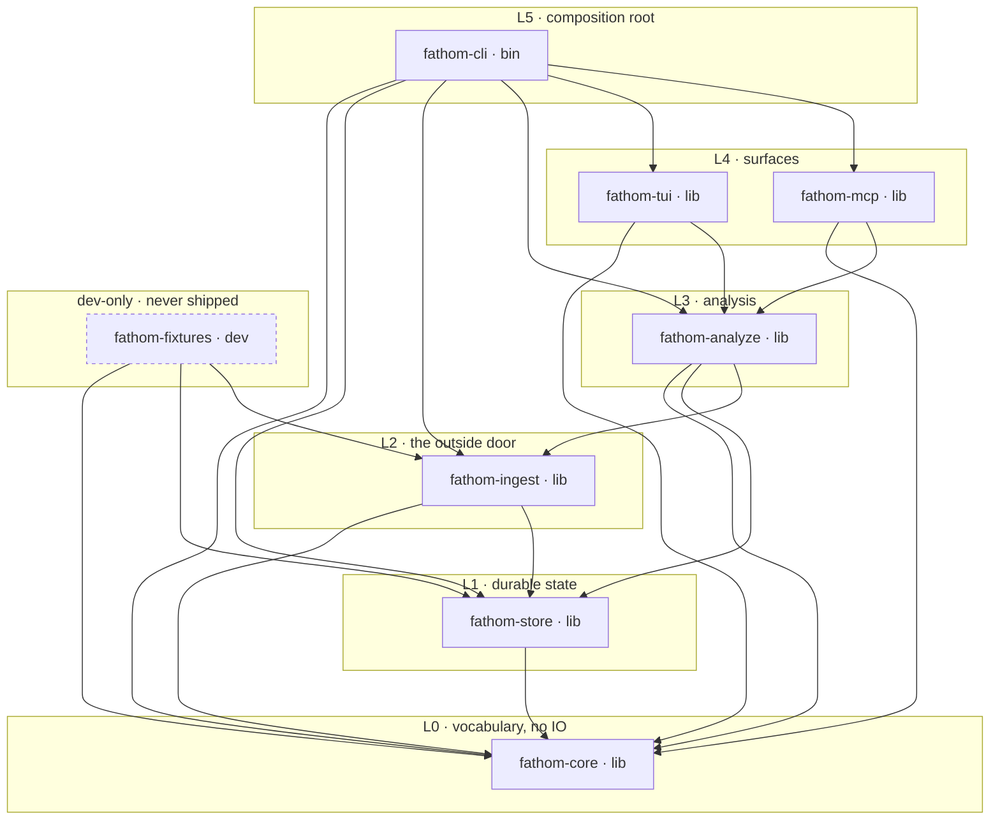

# ADR-002 — Rust workspace layout and crate boundaries

- **Status**: Accepted
- **Date**: 2026-10-14
- **Ticket / plan key**: `reco-a54` / `e0.2`
- **Implements**: [ADR-001](0001-product-thesis.md) — especially §7.4 (deterministic by default), §7.5
  (local by default), §7.10 (one reality) and §8's non-goals
- **Constrains**: `reco-e77` (`e0.7` the workspace scaffold, CI matrix and release skeleton),
  `reco-dq3` (`e0.8` config), `reco-5vz` (`e0.9` path taxonomy), `reco-whw` (`e0.10` fixtures),
  `reco-pef` (`e0.11` budget gate), and through them every ticket in epics 1–7 (§11 maps all of them)
- **Owned by the plan as**: the decision that must exist before a second person runs `cargo build`
- **Executable half**: `tools/workspace_model.py` (the model) + `tools/check_workspace.py` (renderer and
  boundary lint) + `tests/test_workspace_contract.py`

**Normative tables in this document are generated** from `tools/workspace_model.py` by
`python3 tools/check_workspace.py write`; `check` fails CI on drift. The precedent is `tools/gen_adr_tables.py`
and ADR-004 §17: a contract restated by hand is a contract that drifts from the thing it describes, and
the drift is always discovered somewhere expensive.

---

## 0. Why this document exists, and what it decides

Epics 0–7 are **seventy-seven buildable tickets** — everything in `.plan/plan.json` that is
not a decision, an epic or a milestone. The plan says they are staffed by **eleven teams of
one**, working in parallel, in one repository, with no integration manager. That staffing model has one
hard requirement: *the places two people can touch at the same time must be small, and the places one
person may not touch must be enforced by a machine rather than by a review comment.*

Review comments do not survive a rebase. `rustc` does. So the substance of this ADR is not the crate
list — the crate list is obvious — it is **the twelve rules in §5 and the lint in §8 that make
them unbreakable**. Concretely, this document decides:

1. the toolchain floor and its upgrade policy (§2);
2. the eight crates, their layers, and what each one owns (§3, §4);
3. the allowed dependency direction, including two edges the layering would permit and this ADR does
   not (§5);
4. the module boundary the TUI and the MCP server must cross — one façade, one versioned delta model
   (§5.3);
5. the feature-gate policy, the `net-*` naming rule and the no-network-by-default claim (§6);
6. error handling, panics, `unsafe`, exit codes and the shared clippy policy (§7);
7. what CI must run, checked by CI itself (§8);
8. which team owns which modules, so eleven people do not collide (§9).

Two things it deliberately does **not** decide are named in §10 rather than left implicit: the
workspace's licence field (the product owner's call, with a default shipped so `e0.7` is not blocked)
and everything `e0.7` itself owns — pinning dependency versions, the runner matrix, `cargo-dist`.

### 0.1 Constraints inherited, not chosen

| Source | Constraint | Where it lands |
|---|---|---|
| ADR-001 §7.4 | Identical input yields identical bytes, in analyses, scores, narratives and exports | §3 (`fathom-core` has no clock), §6.4 (a feature may not change a serialised shape) |
| ADR-001 §7.5, §8.5 | No network call unless the user turned a named feature on | §6.2, §6.3, lint `N01`–`N05` |
| ADR-001 §7.6 | Degrade, never block — a missing analyzer is a stated partial answer, not a stalled index | §7.2 (no `panic`, no `unwrap`, no `todo!()` in a library) |
| ADR-001 §7.10 | **One reality**: TUI, CLI, CI, export and MCP all read the same versioned structure | §5.3 (the `insight` façade), lint `M02` |
| ADR-001 §8.2 | Not a git client: no fetch, no push, no remote | §6.5 (`gix` local-only feature allow-list, `git2` banned) |
| ADR-004 D2, D3 | Bundled SQLite with `STRICT`, `->>` and FTS5 | §6.1 (`sqlite-bundled`), §4 (`fathom-store`) |
| ADR-004 §5.1, §5.7 | Analyzer manifest with a version bump per behaviour change | §6.4 (a compiled-in feature is a behaviour change) |
| ADR-005 §4 | MCP surface is read-only-first, capability-gated in the server | §4 (`fathom-mcp`), §6.3 (stdio is not a network feature) |
| ADR-005 §10 | An mmap claim must be probe-gated, because a naive check reports success | §3 (`unsafe` confined to `fathom-store/src/raw/`, gated by `feature = "mmap"`) |
| thesis glossary | *Network consent* is an explicit per-feature user decision | §6.3 (compile-time opt-in **and** consent key, both required) |

---

## 1. The shape, in one picture

The rule, in the ticket's own words:

```
cli ──▶ { tui, mcp } ──▶ analyze ──▶ ingest ──▶ store ──▶ core
```

Every arrow points **downhill**. A dependency that points the other way is an *uphill* import, and the
CI job in §8 stops it. The diagram below is generated from the model; the arrows are `[dependencies]`,
the dotted ones are `[dev-dependencies]`.

<!-- BEGIN GENERATED: diagram -->


Arrows are `[dependencies]`; every arrow points to a strictly lower layer (R1). `fathom-fixtures` is dashed because it is a `[dev-dependencies]` crate and nothing else (R7) — no production crate depends on it. There is no arrow from `fathom-tui` or `fathom-mcp` to `fathom-store` even though the layering would allow it (§5.2), and the two arrows that do exist from those crates are narrowed to `insight`/`export` by §5.3.
<!-- END GENERATED: diagram -->

Read the picture by what is *missing*: there is no arrow from `fathom-tui` or `fathom-mcp` to
`fathom-store`, even though the layering would allow it (§5.2); there is no arrow from
`fathom-fixtures` into anything (it is a leaf nobody ships, §4.4); and there is no crate called
`fathom-config` (§4.5).

---

## 2. Toolchain: edition, MSRV and the upgrade policy

<!-- BEGIN GENERATED: toolchain -->
| Setting | Value | Declared once in |
|---|---|---|
| edition | `2024` | `[workspace.package] edition` |
| MSRV (`rust-version`) | `1.97.0` | `[workspace.package] rust-version` |
| edition floor | `1.85.0` | edition 2024's own minimum, checked by `check` |
| cargo resolver | `3` — v2 semantics + MSRV-aware selection | `[workspace] resolver` |
| local toolchain | pinned to the MSRV in `rust-toolchain.toml` | repo root |
| clippy | `-D warnings` plus §8's strict set | `[workspace.lints]` |
| rustfmt | `cargo fmt --check` is a hard failure | `rustfmt.toml` |
| cargo-deny | licences + advisories + sources | `deny.toml` (§8) |

| MSRV policy clause | Statement |
|---|---|
| Where the number lives | Once: `[workspace.package] rust-version` in the root `Cargo.toml`; every crate inherits it (`rust-version.workspace = true`). A crate that restates its own `rust-version` fails the lint. |
| Who may raise it | At most once per calendar quarter, only in a minor release of fathom, never inside a major. The bump is a one-line PR that changes `rust-version`, this constant and the ADR table. |
| Supported window | The declared MSRV plus the two newest stable minors. `stable` and `MSRV` are both in the CI matrix (§8); a third job runs `beta` as allowed-to-fail so a regression is known before it ships. |
| How a break is caught | CI builds `--workspace --no-default-features --features minimal` on the MSRV toolchain and `--workspace --all-features` on stable. Developers build on the MSRV via `rust-toolchain.toml`, so a dependency that needs newer Rust is discovered locally, not by a user. |
| Dependencies | A dependency whose `rust-version` exceeds the MSRV may not be added without an exception entry in `[workspace.metadata.fathom.msrv-exceptions]` with a `why = ` string; resolver = "3" keeps the lockfile honest, the exception list keeps *why* the honest thing is a carve-out visible. |
| Dropping support | A dropped MSRV is a `Minor` change in `CHANGELOG.md` under `## Toolchain`, because it is a breaking change for whoever is on the distro toolchain, and packagers do not read commit logs. |

Observed toolchain while writing this ADR: `rustc -vV` reports release **1.99.0** (commit date 2026-09-28, `aarch64-unknown-linux-gnu`), and `gcc`/`cc` **are** present, so `sqlite-bundled` and the tree-sitter grammars build here. MSRV = latest − 2 = **1.97.0**.
<!-- END GENERATED: toolchain -->

Three notes on the numbers.

**Why edition 2024 and not 2021.** The workspace is greenfield: there is no edition-2021 code to
migrate, and edition 2024's changes (`unsafe_op_in_unsafe_fn` as a hard error, `gen` reserved, RPIT
lifetime capture rules) are exactly the ones that matter to a codebase whose `unsafe` budget is
deliberately one gated module. Paying the migration cost later, with 400k lines in the tree, is the
expensive option.

**Why `resolver = "3"`.** Version-2 resolution plus the MSRV-aware resolver means a dependency that
requires Rust newer than our MSRV is *not selected* during resolution. Without it, MSRV drift is
discovered by whoever runs `cargo build` on the distro toolchain — which is to say, never, and then all
at once.

**Why `rust-toolchain.toml` pins the MSRV rather than `stable`.** Reproducibility of the analysis, not
of the compiler: a golden test is only evidence if two machines agree on what the code does, and the
cheapest way to keep them agreeing is to develop on the floor. CI then proves the ceiling
(`stable`, `beta`) is still standing.

---

## 3. The crates

<!-- BEGIN GENERATED: crates -->
| Crate | Kind | Layer | Owner | May depend on | Non-optional externals | `unsafe` |
|---|---|---|---|---|---|---|
| `fathom-cli` | bin | L5 | cli | `fathom-core`, `fathom-store`, `fathom-ingest`, `fathom-analyze`, `fathom-tui`, `fathom-mcp` | `clap`, `clap_complete`, `eyre`, `color-eyre`, `tracing`, `tracing-subscriber`, `serde`, `serde_json`, `toml_edit` | forbidden |
| `fathom-mcp` | lib | L4 | mcp | `fathom-core`, `fathom-analyze` | `rmcp`, `serde`, `serde_json`, `thiserror`, `tokio` | forbidden |
| `fathom-tui` | lib | L4 | tui-shell / tui-views | `fathom-core`, `fathom-analyze` | `ratatui`, `crossterm`, `unicode-width`, `unicode-segmentation`, `thiserror`, `serde`, `serde_json`, `signal-hook` | forbidden |
| `fathom-analyze` | lib | L3 | analyze-change / analyze-arch / analyze-agents / analyze-insight | `fathom-core`, `fathom-store`, `fathom-ingest` | `serde`, `serde_json`, `thiserror`, `regex`, `similar`, `toml_edit`, `globset`, `rayon`, `smallvec` | forbidden |
| `fathom-fixtures` | dev | L3 | fixtures | `fathom-core`, `fathom-store`, `fathom-ingest` | `gix`, `serde`, `serde_json` | forbidden |
| `fathom-ingest` | lib | L2 | ingest-git | `fathom-core`, `fathom-store` | `gix`, `filetime`, `serde`, `serde_json`, `sha2`, `thiserror`, `rayon` | forbidden |
| `fathom-store` | lib | L1 | store-index / store-cache | `fathom-core` | `rusqlite`, `rustix`, `serde`, `serde_json`, `thiserror`, `fallible-iterator` | `src/raw/` only, `cfg(mmap)` only |
| `fathom-core` | lib | L0 | core | — | `serde`, `serde_json`, `thiserror` | forbidden |

**`fathom-cli`** (L5, bin) — The `fathom` binary and its verbs (ADR-005 §6, `e1.10`): argument parsing, config discovery and layering, process wiring, terminal restoration, exit codes, `doctor`, `fathom check`, and the `watch` daemon supervisor. The composition root.

> **The only crate with default features, and the only crate that may use `eyre`.** Its default set *is* the shipped product; §6 publishes it, and `fathom --version` prints the resolved feature set so a bug report says what was compiled.

> `main.rs` is thin: parse, build a `Context`, dispatch to a `verbs::` module that returns `fathom_core::exit::ExitCode`. No analysis, no SQL, no ratatui.

**`fathom-mcp`** (L4, lib) — The MCP server: tool surface, capability gating, approval tokens, contract versioning (ADR-005 §4), and the shared review memory the agent writes back through it.

> **stdio is the default transport, and it is not a network feature.** MCP over stdio opens no socket; the same JSON-RPC handler serves both transports, so gating the transport does not gate the tool surface, and vice versa — the capability gate lives in the handler (ADR-005 §4.3).

> `tokio` is a dependency with an explicit feature list that must never include `net` (`ALLOWED_TOKIO_FEATURES`); "no network" must survive a feature unification accident.

**`fathom-tui`** (L4, lib) — The ratatui application: event loop, focus model, keymap, responsive layout, the view inventory (queue, timeline, diff, structure, deps, ambient), search UI, theming. A library, not a binary, so `fathom-cli` owns the process and the exit code.

> No terminal-size or clock reads outside the frame loop: rendering takes a `FrameContext` so views are testable headlessly at a fixed 80x24 (`e5.5`).

> The TUI never holds a store handle and never computes a score: ADR-001 §7.10 ("one reality") makes `insight` the only source of what it draws.

**`fathom-analyze`** (L3, lib) — Every analysis: path taxonomy and noise policy, structure and rename deltas, dependency manifest/lockfile parsers, non-code and test surfaces, tree-sitter structural extraction, the module graph, cycles, layering, API surface, hotspots, attribution, intent, pathology detectors, risk scoring, the attention queue, the review ledger's derivation, narratives and export. Also the owner of **`insight`**, the one versioned delta model (§5).

> **IO-free by choice, not by accident.** Analysis reads through `fathom-ingest` and `fathom-store` and is a pure function of (input, config), which is what makes golden tests and ADR-004 §5's cache keys mean something. Four teams share this crate; the module ownership split is in §9.

> `insight` and `export` are the narrow waist every surface reads through; `fathom-tui` may also name `search` and `compare` (§5.3), and `fathom-mcp` may not.

**`fathom-fixtures`** (L3, dev) — Deterministic fixture construction: synthetic agent-driven git repositories, hook-event streams, config files, the golden scenario corpus, a fixed `Clock`, and budget-scenario builders. Dev-dependencies only — never in a release build.

> **It may not depend on `fathom-analyze`.** A fixture that computes its own expectations with the code under test verifies nothing; the golden expectations in the corpus are hand-authored data reviewed by a human, so a wrong analysis cannot certify itself.

> Allowed as a dependency only under `[dev-dependencies]`. The lint fails a `[dependencies]` or `[build-dependencies]` entry naming it, which is what keeps fixtures out of the shipped binary rather than merely out of style.

> Fixtures are byte-deterministic: a fixed clock, a fixed author, a fixed commit order, `LC_ALL=C` sort order, and no `SystemTime` anywhere, so a golden file diff means a real behaviour change and not a flake.

**`fathom-ingest`** (L2, lib) — Getting facts in from outside: git object access via `gix` (read-only over the local object database), commit normalisation, episode segmentation, the hook-event reader, validator and replay (ADR-005), and watch-mode change detection.

> **`gix` with `default-features = false`.** The dependency is non-optional — the git spine is the product — but the feature list is pinned to a local-only allow-list (`GIX_ALLOWED_FEATURES`). This is what keeps the non-goal "fathom is not a git client" true at the dependency level: no fetch, no push, no remote, and no transport stack that could do it if somebody forgot (§4.2).

> `git2`/`libgit2` is banned outright: one path to git objects, and libgit2 links a TLS stack we would have to audit to prove it is never called.

**`fathom-store`** (L1, lib) — The SQLite index, cache and blob store: schema and migrations, the analyzer manifest and cache keys, the invalidation matrix, retention/pruning, the writer lease, and the `.fathom/` layout. Owned by ADR-004; this ADR only says which crate holds it.

> `unsafe` is permitted **only** in `src/raw/` and **only** under `#[cfg(feature = "mmap")]`, with a `// SAFETY:` comment per block (`clippy::undocumented_unsafe_blocks = "deny"`). A default build of every crate in this workspace therefore compiles zero `unsafe`.

> Startup asserts the SQLite compile options ADR-004 §4.0 requires (WAL, `STRICT`, FTS5, JSON1) and reports `SQLITE_COMPILE_OPTION_MISSING` through `fathom doctor` rather than running a schema whose meaning has changed under it.

**`fathom-core`** (L0, lib) — The domain model and every cross-crate contract: `Episode`, `EpisodeDelta`, `AttentionQueue`, `ReviewLedger`, `Finding`, ids, the versioned JSON shapes, error vocabulary, exit codes, and the *typed* config schema (types only — no file reading).

> **Zero IO, zero unsafe, zero clock.** No `std::fs`, `std::net`, `std::process`, `std::env`, `std::thread::sleep`, no wall clock: time enters as a `Timestamp` value and `core::time::Clock` is a trait whose only implementations live in `fathom-cli`. Determinism is the property this buys: identical input, identical bytes (ADR-001 §7.4).

> Because everything cross-crate is defined here, `fathom-core` is the one crate whose *public API* is a published contract: `missing_docs = "deny"`, and a change to a serialised shape is a `result_schema_version` decision owned by ADR-004 §5.
<!-- END GENERATED: crates -->

### 3.1 Why eight crates and not one crate with modules

Rust module visibility is *per-crate*: `pub(crate)` means "pub to the whole crate", and there is no
`pub(sibling_module)`. A single `fathom` crate with `mod store`, `mod analyze`, `mod tui` therefore
cannot express "the TUI may not reach into the store" — the compiler has no opinion, the opinion lives
in a review checklist, and checklists are what this ADR exists to replace. Crate boundaries are the
only visibility Rust can enforce, and `cargo` will not even compile crate A before crate B if the
graph says they are independent, which is also what makes eleven parallel teams possible (§9).

### 3.2 Why eight crates and not twenty

Every extra crate costs a `Cargo.toml`, a place for a version, and a boundary somebody later has to
justify. The cut is made where **ownership changes**, where an **IO boundary** falls, or where a
**build-cost cliff** exists — not where a directory of files feels big. Two candidate crates were
refused:

- `fathom-config` (`e0.8`) — refused, see §4.5.
- `fathom-graph` (epic 3's module graph) — refused: same owner as `fathom-analyze`'s `graph/` module,
  same IO profile, no build-cost cliff. If `s3` shows the graph lane needs its own compile-time budget,
  splitting `fathom-analyze` is a `Minor` change: the façade in §5.3 is what makes that split a move
  rather than a rewrite.

### 3.3 Naming

Crate `fathom-x`, module `fathom_x`, binary `fathom`, verbs as subcommands. One crate prefix means
`cargo search`, `cargo tree` and a stack trace all agree about who owns what, and it makes the lint's
job tractable: an uphill import is lexically recognisable (§8.2).

---

## 4. What each crate owns, and the two crates that are special

### 4.1 `fathom-core` — the contract crate, with zero IO

`fathom-core` is the only crate whose public API is a *published* contract in the ADR-004 sense: its
serialised shapes are what `result_schema_version` (§5 of that document) versions. It has no default
features, no IO, no clock, no `unsafe`, and its dependency list is three crates long on purpose.

The clock rule is the one people argue with. `fathom-core` may not read the time, so analysis receives
timestamps as data and `Clock` is a trait whose only implementations are in `fathom-cli`. The
alternative — `SystemTime::now()` inside a detector — silently makes every golden test in epic 2 and 4
time-dependent, which is how a "deterministic by default" product (ADR-001 §7.4) turns into a product
whose exports cannot be reproduced and whose sign-offs cannot be trusted.

### 4.2 `fathom-ingest` — the only door for outside facts

Git objects, hook-event files, and filesystem watches all enter here, and everything upstream consumes
values. The rule that keeps this honest at the dependency level: **`gix` with
`default-features = false`** and a feature list pinned to a local-only allow-list (lint `N05`).
`gix` can talk to remotes; enabling `fathom` to do so is a one-line dependency change that would
silently cross ADR-001 §8's "not a git client" line, so the line is drawn in the manifest, not in the
wiki. `git2`/`libgit2` are banned outright in `deny.toml` and by the lint: one path to git objects, and
libgit2 drags in a transport stack that would have to be audited to prove it is never called.

### 4.3 `fathom-cli` — the composition root, and the only binary

`fathom-cli` is the only crate with default features (§6.1) and the only crate allowed to use `eyre`.
Its `main.rs` parses, builds a `Context` (resolved config, store handle, clock, terminal restorer) and
dispatches to a verb module that returns `fathom_core::exit::ExitCode`. No SQL, no analysis, no
`ratatui` — if a verb needs logic, the logic is a downhill crate's function.

**One binary, not eight.** Subcommands in separate binaries would mean eight distributable artefacts,
eight version strings, eight sets of feature decisions, and a `fathom check` in CI that can disagree
with the `fathom index` that produced the store it is checking. A separate `fathom-mcp` binary is
refused for the same reason: `fathom mcp serve` is a verb in the same process, so the agent and the
human see the same bytes.

### 4.4 `fathom-fixtures` — dev-only, and it may not know what the answer is

Two hard rules, both enforced.

It may be depended on only as `[dev-dependencies]` (lint `E05`), which is what makes "fixtures are not
in the shipped binary" a fact rather than an intention — a stray `src/` import is exactly the kind of
thing a deadline produces.

It may **not** depend on `fathom-analyze`. A fixture that computes its expected output with the code
under test verifies nothing: a wrong analysis would certify itself, forever. The golden expectations in
`e0.10`'s corpus are hand-authored data reviewed by a human, which is the only way a golden file can
disagree with reality.

A third thing, settled when the crate was built: `e0.10` (`reco-whw`) publishes **no features**, which
amends the `corpus` row §6 was drawn with. The golden corpus is compiled in unconditionally — the
ground-truth files are `include_str!`d — because a scenario whose expectations are missing must be a
compile error, and a feature whose off position compiles a crate that materialises repositories with no
expectations is a knob that switches the point of the crate off.

### 4.5 There is no `fathom-config` crate

`e0.8`'s config system splits along the IO line, like everything else here. The **typed schema** — the
layer names, noise globs, risk weight keys, keymap structure — is `fathom-core`: it is domain
vocabulary, and every crate must see the types without acquiring the ability to read a file. The
**discovery and layering** (flags > env > repo `fathom.toml` > user file > defaults, the
`config explain` trace) is `fathom-cli`: it is IO, and exactly one process should decide what the
config is.

The consequence is a rule worth stating on its own, because it is what makes `fathom config explain`
ever able to be true:

> **No crate below `fathom-cli` reads configuration, environment variables or files to find out how it
> should behave.** The resolved root config is passed in as a value. A crate that reads
> `std::env::var` to change an analysis result is a crate whose cache keys (ADR-004 §5.5) are lying.

That is lint `W1` on `fathom-core`, `fathom-analyze`, `fathom-tui` and `fathom-mcp`.

---

## 5. The rules, and the two edges the layering would allow but this ADR does not

<!-- BEGIN GENERATED: rules -->
| # | Rule | Enforced by |
|---|---|---|
| **R1** | Crate edges follow `cli -> {tui,mcp} -> analyze -> ingest -> store -> core`; an `uphill` import fails CI. | `lint` → `E01`, `E02`, `E03`, `E04` |
| **R2** | `fathom-tui` and `fathom-mcp` name `fathom-analyze` only through its façades — `insight` and `export`, plus `search` and `compare` for the shell — and only *read* what those hand back: a surface that composes, ranks or classifies is a second analysis (`M03`). | `lint` → `M02`, `M03` |
| **R3** | `fathom-core` has zero IO, zero `unsafe`, no wall clock and no default features. | `lint` → `W1`, `W2`, `P02`, `F02` |
| **R4** | `unsafe` appears only in `fathom-store/src/raw/` and only under `cfg(feature = "mmap")`. | `lint` → `P02`, `P03`, `P04` |
| **R5** | Library crates declare `default = []`. Only `fathom-cli` has default features, and they are the shipped product. | `lint` → `F02`, `F03`, `H01` |
| **R6** | A default build links zero network-capable crates; every feature that can touch a socket is named `net-*`, is off by default, and needs runtime consent. | `lint` → `N01`–`N05`, `check` → shipped-closure test |
| **R7** | `fathom-fixtures` is a dev-dependency and nothing else. | `lint` → `E05` |
| **R8** | One `rust-version`, one `edition`, inherited from `[workspace.package]`. | `lint` → `T01`, `T06` |
| **R9** | `pub mod` is declared in `lib.rs` only; `#[path = "../.."]` is banned. | `lint` → `W3`, `W4` |
| **R10** | Libraries return `thiserror`; only `fathom-cli` may use `eyre`. No `todo!()` in a library crate. | `lint` → `W5`, `W6`; clippy `unwrap_used` |
| **R11** | The feature list in this ADR is the published list: an undeclared feature fails the lint. | `lint` → `F01` |
| **R12** | The lint is wired into CI, and CI is checked for it (§8). | `check` → `C01` |
<!-- END GENERATED: rules -->

### 5.1 Uphill is not allowed, and the word means something specific

`crate A` imports `crate B` **uphill** when `B`'s layer is greater than or equal to `A`'s. Layers come
from the model, not from the dependency graph, so a cycle cannot hide inside the definition (the model
is cycle-checked separately, lint `E04`). Two of these are worth naming because they are the ones
somebody will want:

- `fathom-analyze → fathom-tui`, wanted whenever a view needs a number it does not have. The answer is
  to add the number to the delta model in `fathom-analyze` and render it, not to invert the edge.
- `fathom-store → fathom-ingest`, wanted whenever the store wants to know where a row came from. The
  answer is a column, not an edge.

### 5.2 Two edges the layers allow and this ADR forbids

`fathom-tui → fathom-store` and `fathom-mcp → fathom-store` are downhill, and both are
**forbidden** (`E01` lists the reason in the failure message). They are forbidden because they are the
easiest way to break ADR-001 §7.10. A TUI that can hold a `Store` will eventually run its own query,
compute its own page, and pick its own ordering; a week later the MCP server picks a different page size
for the same list, and the human and the agent are now looking at two realities — the exact failure the
thesis calls a bug with a severity. `e2.11` exists to prevent that, and an edge would prevent `e2.11`.

### 5.3 The narrow waist: `insight` and `export`

`fathom-analyze::insight` is the only module `fathom-tui` and `fathom-mcp` may name inside
`fathom-analyze` (`export` is the second, for `e5.7`'s review artefact, which must be byte-identical
whether it is produced by `fathom export`, by the TUI, or over MCP). The façade is a **service**, not a
bag of types: it owns pagination, the memory budget, the truncation flags, and the `unknown` values, so
that "how many episodes does a page hold" has exactly one answer in the whole product (ADR-004 §5.6
makes the same argument about `resolve()`).

Lint `M02` enforces this at the *path* level: `use fathom_analyze::detectors::x;` in `fathom-tui`
fails CI with the reason in the message. When a view genuinely needs something the façade does not
expose, the façade gains a method — in a PR that `analyze-insight` reviews — and that review is cheap
because the façade is small.

**e5.2 and e5.3 widened the shell's list by two, and only by two.** `fathom-tui` may also name
`fathom_analyze::search` and `fathom_analyze::compare`. Both are the same shape of permission, and neither
is a licence to analyse: the `/` box *scores* a corpus the composition root read and handed over
(`Options::search`), because the scoring function has to be the one `fathom search` uses or the two surfaces
rank a query differently; the palette *decodes* the session rows a named comparison is stored under,
because a second spelling of that key is a saved comparison that survives a restart by accident. Neither
module is opened, paged or built inside the shell — `M03` still stands, and the corpus and the composed
delta still arrive as finished answers from `fathom-cli`. `fathom-mcp`'s list is unchanged.


---

## 6. Features: what is compiled in, and what may never be

### 6.1 The policy in five sentences

Library crates declare `default = []`. Only `fathom-cli` — the binary — declares default features, and
**its default set is the shipped product**: it is published in the table below, printed by
`fathom --version`, and diffed in CI (`F03`). A feature that costs real compile time or binary size
must be optional and named here (`H01`, `H02`). A feature that can touch a socket **must** be prefixed
`net-`, must be off by default, and must have a runtime consent key (`F04`, `N06`). A library built
with no features is a valid, testable configuration, which is why `cargo test --workspace
--all-features` and `cargo build -p fathom-cli --no-default-features --features minimal` both run in CI
(§8).

The reason for pushing every choice down to the binary rather than spreading defaults across the
libraries is that feature flags are **unified** per build, not per crate: one `default = ["yaml"]`
buried in `fathom-store` turns on `serde_yaml` for the whole workspace, including the binary nobody
meant to grow. One decision point makes that class of accident visible in one diff.

### 6.2 The published feature list

<!-- BEGIN GENERATED: features -->
| Crate | Feature | In default build | Net | Heavy | What it turns on | Runtime consent key | Ticket |
|---|---|---|---|---|---|---|---|
| `fathom-core` | `json-schema` | no | — | yes | emit the JSON Schema for `fathom.toml` and the delta model (`schemars`); used by the generator job, never by the runtime path. | — | e0.8 |
| `fathom-store` | `sqlite-bundled` | no | — | yes | compile SQLite from source (`rusqlite/bundled`); needs a C compiler, guarantees `STRICT`, `->>` and FTS5 (ADR-004 D2). On in the shipped binary. | — | e0.4 |
| `fathom-store` | `sqlite-system` | no | — | yes | link the distro's libsqlite3 instead. Off by default; exists for distro packagers who will not ship a vendored C library. Mutually exclusive with `sqlite-bundled`. | — | e7.4 |
| `fathom-store` | `mmap` | no | — | yes | mmap-backed index reads (ADR-005 §10's MAP_SHARED clause, `e1.4`). Off by default because ADR-004 D4 keeps `mmap_size = 0` until the probe says otherwise, and because this is the only place in the workspace allowed to contain `unsafe`. | — | e1.4 |
| `fathom-ingest` | `watch` | no | — | yes | filesystem change detection (`notify`, inotify/FSE/ReadDirectoryChangesW backend) for `fathom watch` and watch mode v1. | — | e1.9 |
| `fathom-ingest` | `watch-poll` | no | — | yes | polling backend for the same crate, for NFS/SMB and other filesystems where inotify lies (ADR-004 §7.8). | — | e1.9 |
| `fathom-ingest` | `mmap-index` | no | — | — | mmap the index files this crate writes; forwards to `fathom-store/mmap`, where the only `unsafe` lives. | — | e1.4 |
| `fathom-analyze` | `lang-rust` | no | — | yes | tree-sitter grammar for Rust. | — | e3.1 |
| `fathom-analyze` | `lang-python` | no | — | yes | tree-sitter grammar for Python. | — | e3.1 |
| `fathom-analyze` | `lang-go` | no | — | yes | tree-sitter grammar for Go. | — | e3.1 |
| `fathom-analyze` | `lang-typescript` | no | — | yes | tree-sitter grammar for TypeScript/TSX. | — | e3.1 |
| `fathom-analyze` | `lang-ruby` | no | — | yes | tree-sitter grammar for Ruby. | — | e3.1 |
| `fathom-analyze` | `lang-java` | no | — | yes | tree-sitter grammar for Java. | — | e3.1 |
| `fathom-analyze` | `langs-all` | no | — | — | every grammar `s1` measured as worth shipping; the shipped binary enables this and nothing else needs to. | — | e3.1 |
| `fathom-analyze` | `net-advisories` | no | **yes** | yes | outbound HTTPS advisory/provenance lookups (OSV) for dependency risk signals (`e2.7`). Requires runtime network consent; degrades to `unknown` offline. | `privacy.advisories` | e2.7 |
| `fathom-analyze` | `sqlite-bundled` | no | — | yes | the store-facing half of the crate (`index`, `sink`) — which is ADR-004 §6's incremental index — compiled in, by forwarding to `fathom-store`'s own feature of the same name. Same reason that crate gates: a library built with no features must still build and test. | — | e1.4 |
| `fathom-analyze` | `sqlite-system` | no | — | yes | the same half, against the distro's libsqlite3. | — | e7.4 |
| `fathom-analyze` | `net-llm` | no | **yes** | yes | **Unwired: spike `s5` closed the question (`reco-nv0`).** Reserved for optional LLM narrative polish (`e4.7`); the spike measured a polished arm against the template and shipped neither it nor the seam, so `e4.7` ships the deterministic template alone ([episode narrative](../concepts/episode-narrative.md), [the spike](../concepts/narrative-polish.md)) and the decision is a queryable fact (`narrative::llm::SHIPPED` is false, `narrative::llm::GATES` holds the five conditions). This feature has no consumer, no code path and no `privacy.llm` surface until every gate is met; it stays listed so the seam it was meant for stays visible. | `privacy.llm` | e4.7 |
| `fathom-analyze` | `deps-node` | no | — | — | the npm/yarn/pnpm surface: `package.json`, `package-lock.json` v1–v3, `yarn.lock` v1 and Berry, `pnpm-lock.yaml`, `pnpm-workspace.yaml`. | — | e2.5 |
| `fathom-analyze` | `deps-cargo` | no | — | — | `Cargo.toml` (package, workspace, targets, features) and `Cargo.lock` v1–v4. | — | e2.5 |
| `fathom-analyze` | `deps-python` | no | — | — | `pyproject.toml` (PEP 621, Poetry, PEP 735 groups, uv sources), `requirements*.txt`, `poetry.lock`, `uv.lock`, `Pipfile.lock`. | — | e2.5 |
| `fathom-analyze` | `deps-go` | no | — | — | `go.mod` (require/replace/exclude/tool, `// indirect`), `go.sum`, `go.work`. | — | e2.5 |
| `fathom-analyze` | `deps-ruby` | no | — | — | `Gemfile` (best-effort DSL) and `Gemfile.lock` (GEM/GIT/PATH sections with resolved edges). | — | e2.5 |
| `fathom-analyze` | `deps-elixir` | no | — | — | `mix.exs` and `mix.lock`. | — | e2.5 |
| `fathom-analyze` | `deps-jvm` | no | — | — | Maven `pom.xml` and Gradle build files, best-effort and read-only: no build logic is executed, so `${property}` stays verbatim. `gradle.lockfile` too. | — | e2.5 |
| `fathom-analyze` | `deps-dotnet` | no | — | — | SDK-style `*.csproj`, `Directory.Packages.props` (central package management) and `packages.lock.json`. | — | e2.5 |
| `fathom-analyze` | `deps-all` | no | — | — | every dependency ecosystem; the shipped binary enables this, because a review tool that silently skipped the dependencies of the one ecosystem the repository uses is worse than one that admits it. | — | e2.5 |
| `fathom-tui` | `graph-layout` | no | — | yes | force-directed layout for the architecture map (`petgraph`). | — | e3.4 |
| `fathom-mcp` | `net-http-transport` | no | **yes** | yes | streamable-HTTP/SSE transport in addition to stdio: this listens on a socket, so it is consent-gated like any egress and is off by default. | `privacy.mcp_http_transport` | e6.4 |
| `fathom-cli` | `tui` | **yes** | — | — | compile the terminal UI in; `fathom` with no verb. Drop it for a headless CI binary that only runs `fathom check` and `fathom index`. | — | e1.5 |
| `fathom-cli` | `mcp` | **yes** | — | — | compile `fathom mcp serve` in. | — | e6.4 |
| `fathom-cli` | `watch` | **yes** | — | — | compile watch mode and `fathom watch` in; forwards to `fathom-ingest/watch`. | — | e1.9 |
| `fathom-cli` | `sqlite-bundled` | **yes** | — | — | the shipped SQLite story (ADR-004 D2). | — | e0.4 |
| `fathom-cli` | `langs-all` | **yes** | — | — | every tree-sitter grammar; the product's differentiator ships. | — | e3.1 |
| `fathom-cli` | `deps-all` | **yes** | — | — | every dependency ecosystem (`e2.5`): the deps view, the delta model and `fathom check`'s dependency policy all need it, so it ships. | — | e2.5 |
| `fathom-cli` | `minimal` | no | — | — | the smallest useful headless binary: `--no-default-features --features minimal` is what `e6.6` runs inside CI and what the privacy job inspects. | — | e6.6 |
| `fathom-cli` | `net-advisories` | no | **yes** | — | forwards `fathom-analyze/net-advisories`. | `privacy.advisories` | e2.7 |
| `fathom-cli` | `net-llm` | no | **yes** | — | forwards `fathom-analyze/net-llm`. | `privacy.llm` | e4.7 |
| `fathom-cli` | `net-http-transport` | no | **yes** | — | forwards `fathom-mcp/net-http-transport`: the MCP server listens on a socket instead of speaking stdio. | `privacy.mcp_http_transport` | e6.4 |
| `fathom-cli` | `schema-gen` | no | — | — | builds `schemas/fathom.schema.json` into the binary so `fathom config schema` can print it; CI regenerates and diffs the checked-in file. | — | e0.8 |

Transitive default feature set of the shipped binary (`cargo build -p fathom-cli`, nothing passed):

```
fathom-analyze/deps-all
fathom-analyze/deps-cargo
fathom-analyze/deps-dotnet
fathom-analyze/deps-elixir
fathom-analyze/deps-go
fathom-analyze/deps-jvm
fathom-analyze/deps-node
fathom-analyze/deps-python
fathom-analyze/deps-ruby
fathom-analyze/lang-go
fathom-analyze/lang-java
fathom-analyze/lang-python
fathom-analyze/lang-ruby
fathom-analyze/lang-rust
fathom-analyze/lang-typescript
fathom-analyze/langs-all
fathom-analyze/sqlite-bundled
fathom-cli/deps-all
fathom-cli/langs-all
fathom-cli/mcp
fathom-cli/sqlite-bundled
fathom-cli/tui
fathom-cli/watch
fathom-ingest/watch
fathom-mcp
fathom-store/sqlite-bundled
fathom-tui
```

Linked by that build: `libsqlite3-sys`, `notify`, `tree-sitter`, `tree-sitter-go`, `tree-sitter-java`, `tree-sitter-python`, `tree-sitter-ruby`, `tree-sitter-rust`, `tree-sitter-typescript`. Network-capable crates linked: **none** (R6).
<!-- END GENERATED: features -->

### 6.3 `net-*`: the no-network-by-default claim, made twice

ADR-001 §7.5 promises *no network call unless the user turned a named feature on*, and the thesis
glossary defines **network consent** as an explicit per-feature decision. Two independent gates,
because the failure mode of a single gate is that it is forgotten:

1. **Compile time.** The code is not there. Every network-capable dependency is an optional dependency
   reachable only from a `net-*` feature, so a default binary contains no HTTP client, no TLS stack and
   no listener — verifiable with `cargo tree --no-default-features` and enforced by `N01`–`N03`, which
   fail the build of a *default* graph that links any crate on the network-capable list.
2. **Runtime.** A `net-*` feature that is compiled in still does nothing until the matching consent key
   in `fathom.toml` is true (`privacy.advisories`, `privacy.llm`, `privacy.mcp_http_transport`). With
   consent absent the call site returns `Error::NetworkConsentRequired` and the process exits **8**; a
   user who passed `--features net-advisories` and wonders why nothing is fetched gets told the key, in
   the error message, rather than discovering it in documentation. `fathom doctor --privacy` prints both
   columns for every feature: compiled-in, consented, and the key that changes it.

`fathom-mcp`'s stdio transport is **not** a network feature and that distinction is the point: it opens
no socket, it is what `e6.4` ships, and the capability gate for MCP writes lives in the JSON-RPC handler
(ADR-005 §4.3), where it cannot be bypassed by choosing a different transport. The `net-http-transport`
feature adds a listener, and a listener is exactly as much a privacy decision as an outbound call, so it
wears the same prefix and needs the same consent.

`tokio` is allowed without a `net-*` feature — the MCP SDK needs an executor — but only with
`default-features = false` and a pinned feature list that excludes `net` (`N04`). Feature unification is
precisely the accident that rule defends against: one opt-in turning on `tokio/net` would turn it on for
every crate in the workspace, in a build that still claims to make no network calls.

### 6.4 A feature may not change what a byte means

The rule that keeps determinism and the cache honest:

> **No feature may change the serialised shape of a persisted or exported structure, nor the numeric
> output of an analyzer.** Fields that may be absent are `Option` and versioned into
> `result_schema_version` (ADR-004 §5.2); they are never `#[cfg(feature = ...)]` in and out.

Two consequences, and the second one is a follow-up this ADR owes ADR-004:

- A cache row computed by a build with `lang-rust` compiled in must never answer a lookup made by a
  build without it. The graph analyzer's output genuinely differs between those builds, so the
  compiled-in feature set must reach the analyzer manifest's `version` (ADR-004 §5.1) or the cache key.
  **Follow-up recorded in §10.2.**
- `fathom --version` prints the resolved feature set, and `fathom doctor --privacy` prints the same set
  with the consent column. A bug report then says what was built, which is the difference between a
  reproducible report and a folklore argument.

### 6.5 Heavy gates, and why tree-sitter is not free

Each tree-sitter grammar is its own feature (`lang-rust`, `lang-python`, `lang-go`,
`lang-typescript`, `lang-ruby`, `lang-java`) because each is a C build in the dependency graph and the
six together are the difference between a thirty-second and a four-minute laptop build. `langs-all`
forwards to all six; `e0.7`'s shipped artefact enables `langs-all`, and a developer iterating on the
diff viewer builds `--no-default-features --features minimal` and waits for nothing. `s1` decides
whether any of the six is not worth shipping; dropping one is a feature-list edit here, not a refactor.

The same logic gates `notify` (`watch`, `watch-poll` — the polling backend exists because ADR-004 §7.8
knows inotify lies on NFS), `petgraph` (`graph-layout`), `schemars` (`json-schema`, used by the
generator job and by nothing at runtime), and SQLite's provenance (`sqlite-bundled` vs
`sqlite-system`, which exist for distro packagers who will not ship a vendored C library and are
mutually exclusive — `F05` says so out loud).

---

## 7. Errors, panics, `unsafe` and the shared lint policy

### 7.1 `thiserror` in the libraries, `eyre` at the binary edge

Each library crate exports one `pub enum <Crate>Error` built with `thiserror`, with `#[from]` chains
for its own causes and third-party error types **mapped at the boundary** — a public signature may not
leak `rusqlite::Error`, or every caller becomes coupled to rusqlite's minor versions. `fathom-core`
owns the shared *vocabulary* rather than a shared giant enum (which would force the innermost crate to
know about every outer one — uphill, and refused):

- `ErrorCode`, a stable set of short stable strings (`SQLITE_COMPILE_OPTION_MISSING`,
  `CONFIG_UNKNOWN_KEY`, `NETWORK_CONSENT_REQUIRED`, `NOT_A_REPOSITORY`, …) carried by every crate's
  error;
- `trait Diagnosable { fn code(&self) -> ErrorCode; fn hint(&self) -> Option<&str>; }`, so `doctor` and
  the JSON writers can print an actionable, testable line without matching on six upstream enums;
- `ExitCode` (§7.3), the process contract.

`fathom-cli` alone may use `eyre` (lint `W5`): `fn main() -> eyre::Result<()>`, `?` everywhere inside a
verb, and a single place at the very edge that downcasts the verb's return into an `ExitCode` and prints
the hint. That is what "the error the human sees" and "the exit code CI branches on" being consistent
costs, and it is cheap.

### 7.2 Degrade, never block — so do not panic

ADR-001 §7.6 promises a stated partial answer instead of a stalled index, and a `panic!` in the TUI is
the worst possible failure: the process owns the terminal, so the user loses their screen and the
reason at the same time. Enforced by:

- clippy `unwrap_used`/`expect_used` denied in the strict CI pass (§8.3), on non-test code;
- lint `W6`: no `todo!()` / `unimplemented!()` in a library crate — an unbuilt path returns
  `Error::NotImplemented`, which renders as `unknown` in a view and as a warning in `--json`;
- `panic = "unwind"` in every profile (including `release`). `panic = "abort"` is a size optimisation
  that would delete the one mechanism — a `Drop` guard plus a panic hook — that restores the terminal
  before the process dies. A few hundred kilobytes for not destroying the user's session is not a
  trade; say so in the profile comment.
- the panic hook installed by `fathom-cli` before anything else runs: restore the terminal, print the
  panic and its `ErrorCode`, exit **1**.

### 7.3 Exit codes are a published contract

`fathom_core::exit::ExitCode` is `#[repr(i32)]`, `TryFrom<i32>`, and the table below is what `e6.6`'s
CI gate and `e1.10`'s verbs must agree on. Adding a code here is cheap; inventing one in a verb is how
two scripts end up disagreeing about what `7` means.

<!-- BEGIN GENERATED: exit-codes -->
| Code | Name | Meaning |
|---|---|---|
| `0` | `OK` | did the work, nothing to report |
| `1` | `ERROR` | uncategorised failure; the human-readable cause is on stderr with a code |
| `2` | `USAGE` | clap rejected the arguments (bad flag, unknown verb, missing value) |
| `3` | `NOT_A_REPOSITORY` | `<root>` is not a git repository, or `.git` is unreadable |
| `4` | `STORE_CORRUPT` | store failed its integrity check; `fathom doctor` names the rebuild |
| `5` | `CONFIG_INVALID` | `fathom.toml` failed the schema, or a value is the wrong type |
| `6` | `CANCELLED` | user interrupt (ctrl-c) or the writer lease was lost mid-run |
| `7` | `CHECK_VIOLATIONS` | `fathom check` found findings above the configured threshold (CI reads this) |
| `8` | `NETWORK_CONSENT_REQUIRED` | a compiled-in `net-*` feature was asked to run without consent |
| `9` | `FEATURE_ABSENT` | the verb needs a feature that is not compiled in; the message names it |
| `10` | `UNSUPPORTED_PLATFORM` | platform capability missing (ADR-005 §10's ABI probe refused) |
| `11` | `BUDGET_EXCEEDED` | a perf/RSS budget in `benchmarks/budgets.json` was blown |
| `12` | `INDEX_DEGRADED` | the index is missing, incomplete or stale; the verb names the remedy |
<!-- END GENERATED: exit-codes -->

### 7.4 `unsafe`: one directory, one feature, one comment

`fathom-core`, `fathom-analyze`, `fathom-tui`, `fathom-mcp`, `fathom-cli` and `fathom-fixtures` carry
`#![forbid(unsafe_code)]`. `fathom-store` carries `#![deny(unsafe_code)]` and may contain `unsafe`
**only** under `src/raw/`, **only** inside `#[cfg(feature = "mmap")]`, with a `// SAFETY:` comment per
block (`P02`, `P03`, `P04`, plus clippy `undocumented_unsafe_blocks = "deny"`).

The claim that falls out is the one worth having: **a default build of this workspace compiles zero
`unsafe`** — and it is a checked claim, not an aspiration, because `P03` requires the gate to be present
in the file that contains the block. The single unsafe site is `e1.4`'s mmap'd index reads, which
ADR-005 §10 already requires to be probe-gated: a mapping that cannot be honoured must fail loudly, and
the feature gate is the compile-time half of that same refusal.

### 7.5 Lints live in `[workspace.lints]`, once

The root `Cargo.toml` declares `[workspace.lints.rust]` and `[workspace.lints.clippy]`; every crate has
`[lints] workspace = true` (`A02` fails a crate that omits it, which is how a crate opts out of the
policy by accident). The workspace set is the floor — `unsafe_op_in_unsafe_fn = "deny"`,
`undocumented_unsafe_blocks = "deny"`, `missing_docs = "warn"`, `dbg_macro = "deny"`,
`unwrap_used`/`expect_used` — and a crate may tighten it in its own manifest but never loosen the
workspace entries. `fathom-core` and `fathom-analyze::insight` raise `missing_docs` to `deny`: those two
are contracts, and an undocumented contract is a negotiation.

---

## 8. CI: what runs, and how the lint knows it runs

### 8.1 The gate list

<!-- BEGIN GENERATED: ci -->
| Required step | Text that must appear in `.github/workflows/*.yml` |
|---|---|
| `workspace-boundary-lint` | `tools/check_workspace.py lint` |
| `workspace-boundary-check` | `tools/check_workspace.py check` |
| `cargo-deny` | `cargo deny check` |
| `cargo-msrv-build` | `cargo +$MSRV` |
| `clippy-strict` | `clippy::unwrap_used` |
| `fmt` | `cargo fmt` |
<!-- END GENERATED: ci -->

`tools/check_workspace.py check` fails (`C01`) if any of those strings disappears from
`.github/workflows/*.yml`. That is a deliberate inversion of the usual failure: the ticket's acceptance
criterion is *"cargo-deny + module-boundary lint in CI"*, and a lint that exists but is never invoked is
the most common way such a criterion is quietly missed. So the presence of the invocation is itself a
test.

### 8.2 The boundary lint, in three sentences

`python3 tools/check_workspace.py lint` parses every `crates/*/Cargo.toml` with `tomllib` and every
`.rs` file with regexes, then checks: declared edges against §5; `use`/`extern crate`/full-path
references against §5 *and* against the façade prefixes in §5.3; the feature list against §6.2; the
default-build feature closure for anything network-capable; `gix` and `tokio` feature lists; the inner
attributes in §3 and §7; the location of every `unsafe`; the deny-list in §7; and `deny.toml`'s own
discipline (§8.4). It prints stable rule ids (`E01`, `M02`, `N03`, …) and exits non-zero on any hit.

It is stdlib-only Python for the same reason `tests/conftest.py` says a check that needs an install is a
check that gets skipped: it runs on a clean clone, before `cargo` is invoked, on a machine with no
toolchain, and therefore also runs in a pre-commit hook and in `fathom doctor`.

### 8.3 Rust CI, concretely

```
cargo fmt --all --check
cargo clippy --workspace --all-features -- -D warnings \
    -D clippy::unwrap_used -D clippy::expect_used          # libs+bins only: no --all-targets
cargo clippy --workspace --all-targets -- -D warnings \
    -A clippy::print_stdout                          # tests may unwrap, and a bench may print: the strict set above may not
cargo build --workspace --all-features                     # stable
cargo build -p fathom-cli --no-default-features --features minimal   # the CI-gate binary
cargo +MSRV build --workspace --no-default-features --features minimal
cargo test --workspace --all-features
cargo deny check licenses advisories bans sources
python3 tools/check_workspace.py check
python3 tools/check_workspace.py lint
python3 tools/check_docs.py
```

Matrix: `linux` × `macOS` × `windows`, on `stable` and on the MSRV; `beta` allowed to fail. The
headless `minimal` build is built and tested on every PR because `e6.6`'s CI-gate binary is what users
put inside pipelines, and a TUI-only test suite would never notice that `fathom check` had grown a
dependency on a terminal.

The privacy job (`e6.8`, `reco-h7p`) runs the shipped binary in a network-less namespace and asserts
zero connection attempts, and additionally runs `cargo tree -e normal -p fathom-cli --no-default-features
--features minimal` and fails if any crate on §6's network-capable list appears. Per ADR-005's habit of
marking claims by how they were established: the connection-blocking assertion is `e6.8`'s to write —
this container has no network namespace tooling, so it is recorded here as a requirement with a named
owner rather than as something measured.

### 8.4 `cargo-deny`, and why an ignore needs a signature

`deny.toml` at the workspace root: licences allow-listed by name (copyleft `AGPL-3.0`/`GPL-3.0`
denied); advisories with `yanked = "deny"`; `[sources] unknown-registry = "deny"`,
`unknown-git = "deny"`, git allowed only by explicit entry; `[bans] deny` naming the crates this ADR
refuses outright (`git2`, `libgit2-sys`, `openssl-sys`, `native-tls`, `hyper`) so that reintroducing one
is a deliberate, visible act rather than a transitive accident.

`[bans] multiple-versions = "warn"` rather than `deny`: the tree-sitter grammar crates and `ratatui`'s
transitives will legitimately disagree for a while, and a deny rule that must be bypassed on day one is
a rule that trains people to bypass rules. `wildcards = "deny"` stays denied.

And the clause the lint enforces (`D07`): **every `ignore` / `exception` entry in `deny.toml` carries a
`# why:` comment on the same line.** An unsigned suppression is how a temporary waiver becomes permanent
and invisible, and cargo-deny will not tell anybody it is still there.

---

## 9. Eleven teams of one

<!-- BEGIN GENERATED: teams -->
| # | Team | Crate | Modules owned | Scope |
|---|---|---|---|---|
| 1 | `core` | `fathom-core` | everything | domain model, ids, serialised contracts, exit codes, error vocabulary, the typed config schema |
| 2 | `store-index` | `fathom-store` | src/schema/, src/index/, src/migrations/ | DDL, migrations, the writer lease, FTS |
| 3 | `store-cache` | `fathom-store` | src/cache/, src/retention/, src/raw/ | analyzer manifest, cache keys, pruner, mmap |
| 4 | `ingest-git` | `fathom-ingest` | everything | gix access, normalisation, segmentation, hook events, watch |
| 5 | `analyze-change` | `fathom-analyze` | src/taxonomy/, src/noise/, src/structure/, src/deps/, src/noncode/, src/testsurface/ | epic 2 |
| 6 | `analyze-arch` | `fathom-analyze` | src/graph/, src/cycles/, src/layers/, src/api/, src/hotspots/ | epic 3 |
| 7 | `analyze-agents` | `fathom-analyze` | src/attrib/, src/intent/, src/detect/, src/risk/, src/queue/, src/narrate/, src/export/ | epic 4 + `e5.7` |
| 8 | `analyze-insight` | `fathom-analyze` | src/insight/ | the facade: `e2.11`; owns the schema version and the budget of every view |
| 9 | `tui-shell` | `fathom-tui` | src/app/, src/keymap/, src/layout/, src/ambient/ | epic 5 shell |
| 10 | `tui-views` | `fathom-tui` | src/views/ | queue, timeline, diff, structure, deps, search, compare |
| 11 | `mcp` | `fathom-mcp` | everything | ADR-005 §4 surface, shared review memory |
<!-- END GENERATED: teams -->

The ownership model is *module-level, one owner per file*. `fathom-analyze` hosts four teams and
`fathom-tui` two, which is why the module split is in the model rather than in a wiki: two teams must
never own the same file, and the check that they do not is a list, not a meeting.

Four working rules follow from the layout, and they are the practical reason the boundaries exist:

1. **A cross-crate need is two PRs.** PR one changes the owning crate's public surface (a façade method,
   a core type); PR two consumes it. One PR that does both is where a boundary gets eroded at 18:00 on a
   Friday. `analyze-insight` reviews the façade PR.
2. **A stub is a typed failure, never a panic** (§7.2), so a crate can be compiled and run against a
   neighbour that is not finished — which is the difference between "blocked on another team" and
   "shipped behind a flag".
3. **`cargo check -p <your crate>` must stay fast.** No crate has more than three non-binary internal
   dependencies (`fathom-cli` is the composition root and exempt), which is what keeps the parallel
   build graph wide.
4. **A new crate, a new edge, or a new feature is an ADR-002 change**, in the same PR: `U01`, `E01` and
   `F01` fail otherwise. The ADR is amended before the layout moves, which is what "an ADR is written
   before the code it constrains" means in practice.

---

## 10. What this ADR deliberately does not decide

### 10.1 Deferred, with an owner

| Item | Why it is not decided here | Owner |
|---|---|---|
| Dependency versions, `Cargo.lock`, the runner matrix, `cargo-dist` artefacts, `fathom --version` output format | `e0.7` (`reco-e77`) is the ticket that compiles this shape; the ADR fixes the shape (`python3 tools/check_workspace.py scaffold /tmp/ws` prints it with placeholder versions) | `reco-e77` |
| The workspace `license` field | A licence is a product/governance decision, not an architecture one. The default `MIT OR Apache-2.0` is written into the scaffold because `[workspace.package]` cannot be empty and `e0.7` must not be blocked by an open question; **the product owner should confirm or replace it**, and §8's `cargo deny check licenses` is what makes a later change expensive in the good way | product owner, `reco-e77` |
| Publishing these crates to crates.io | Refused for v1: `publish = false` everywhere. There is no external consumer, and a published crate is an API promise on a moving domain model. Out-of-tree plugins (`e6.7`) compile against `fathom-analyze`'s `plugin` surface in-tree; making that a published crate is an amendment here | `reco-raw` |
| A `wasm32` target as a proof of `fathom-core`'s IO-freedom | A nice, mechanical proof, but it needs a target install and buys what lint `W1`/`W2` already check with fewer moving parts. Revisit if anyone ever proposes a browser build (which ADR-001 §8 makes unlikely) | — |
| Crate-per-verb binaries | Refused in §4.3, not deferred |
| Whether `s3` splits `fathom-analyze` | Named in §3.2 as a `Minor`-sized move; the façade is what keeps it small | `s3` |

### 10.2 One amendment this ADR owes ADR-004

§6.4 shows that a compiled-in feature can change analyzer output, and ADR-004 §5.2's cache key has no
field for the build's feature set. The cheapest correct fix does not touch the key framing: the
**analyzer manifest's `version`** (ADR-004 §5.1) is derived, for graph analyzers, from
`semver + "+" + short_digest(enabled language features)`, so `graph.build` computed with `lang-rust`
off can never answer a lookup made with it on. **Filed** as a child of Epic 1 (`reco-quk`, dependant on
`reco-f28`/`e1.4`, which owns the manifest) — *Analyzer manifest version must absorb the compiled-in
feature set* — and `reco-pef` (`e0.11`) owns the gate that checks version bumps. The requirement is
normative here the moment this ADR is accepted; the ticket only implements it. **Implemented by `e1.15`
(`reco-quk.1`)**: `fathom_analyze::build::feature_digest` is the digest, `Versions::effective_version` puts
it into the version and therefore into key field 3 and the `dep_digest`, and ADR-004 §5.1 states the rule
where the manifest is stated.

### 10.3 What `e0.7` decided when the shape was compiled

§10.1 handed `e0.7` the versions, the lockfile, the runner matrix and the `cargo-dist` artefacts, and an
ADR that had never been compiled found four things it had not anticipated. Each is recorded here rather
than slipped into a manifest, because the point of this document is that the next person reads the
consequences in one place.

| Decision | Why it could not be made as written | What it costs |
|---|---|---|
| **`rusqlite` is optional in `fathom-store`**, gated by the two published SQLite-provenance features, instead of non-optional as §3's table lists it. | A build with *neither* `sqlite-bundled` nor `sqlite-system` would have to link a system `libsqlite3`. This ticket's own acceptance criterion (`cargo build --workspace` on a clean clone) and §8.3's `--no-default-features --features minimal` job on `*-pc-windows-msvc` are exactly that build, and no such library is there. | The shipped binary is unaffected — it turns `sqlite-bundled` on, which is what §6.2 publishes. What changes is the feature-less developer build, which now satisfies §6.1's "a library built with no features is a valid, testable configuration" literally: it compiles with no C toolchain at all. `e1.4` opens a database only behind one of the two features anyway. |
| **`net-http-transport` is a marker feature** with no server crate behind it. | Every streamable-HTTP/SSE server crate in this ecosystem links `hyper`, and `deny.toml`'s `[bans] deny` bans `hyper` unconditionally — cargo-deny bans are not feature-aware (§8.4), so the ban and the feature cannot both exist yet. Choosing a server now would either break the ban on day one or pre-empt it. | §6.2's *name* is published and gated as specified; the listener arrives with `e6.4`, which also owns
either a scoped, `# why:`-signed `skip` in `deny.toml` or a hyper-free server. The feature compiles; it
just compiles nothing yet, and says so in the manifest. |
| **`[licenses] deny` is gone from `deny.toml`**, and rule `D03` moved with it. | cargo-deny 0.20 removed the key (EmbarkStudios/cargo-deny#611). The ADR's §8.4 text asks for a signature on every suppression, which survives; the specific key it named does not. | An allow-list already refuses anything unlisted. `D03` now requires that `AGPL-3.0`/`GPL-3.0` are absent from `allow` **and** named in the file, so the refusal is still written where a reviewer reads it instead of being an omission nobody can find. |
| **`package.repository` is a placeholder** (`github.com/danielstahl/fathom`). | `cargo dist generate` refuses to produce a workflow without a repository URL, and the repository had no remote when this landed. Same pattern §10.1 used for `license`: a documented default so the ticket is not blocked by a governance question. | Whoever pushes the public remote replaces it in the same PR. The installers and `dist-manifest.json` derive their download URLs from it, so a stale value is a broken install, not a cosmetic bug — which is why it is named here and in `CHANGELOG.md`, not only in a comment. |

| **The ADR-005 FFI probe ignores build-output directories.** | The probe asserts the Python contract has no compile step by globbing the repository for `.so` files. The first `cargo build` in the same tree wrote proc-macro `.so` files into `target/debug/deps/`, and `python3 -m pytest -q` — the suite that gates ADR-005 §10 — started failing a tree that had merely been built. | A one-line scope reduction in `src/recommender/harness/elf_probe.py`: ignored build output is not a source-tree fact. A committed extension anywhere else is still a hard failure, and `tests/test_harness_contract.py` is now green in a built tree, which it could not be before `crates/` existed. |

Two smaller things learned by measuring rather than remembering, in the style of §13.1: `gix` 0.89 needs a
hash feature (`sha1`) in its local-only list or `gix-hash` does not compile at all, and `notify` is
`CC0-1.0`, which had to be added to the licence allow-list (with a `# why:` next to it) rather than
silently accepted. Both are in `Cargo.toml` and `deny.toml` with the reason attached.

---

## 11. Every ticket gets a crate

The map is generated from the model and cross-checked against `.plan/plan.json`: a ticket of a
code-owning type with no crate fails (`T04`), and a crate no ticket builds fails (`T05`). Decision
tickets, epics and milestones own no code and are exempt.

<!-- BEGIN GENERATED: tickets -->
| Plan key | Bead | Type | Title | Lands in |
|---|---|---|---|---|
| `e0.7` | reco-e77 | chore | Scaffold cargo workspace, CI matrix and release skeleton | `workspace` |
| `e0.8` | reco-dq3 | feature | Config system: fathom.toml discovery, schema and explanation | `fathom-core`, `fathom-cli` |
| `e0.9` | reco-5vz | feature | Path taxonomy and noise policy engine | `fathom-analyze` |
| `e0.10` | reco-whw | task | Deterministic fixture generator and golden scenario corpus | `fathom-fixtures` |
| `e0.11` | reco-pef | task | Performance budget harness and CI regression gate | `workspace`, `fathom-store` |
| `e0.12` | reco-vm8 | chore | Sequencing checkpoint: reconcile the plan against spike findings | `workspace` |
| `e1.1` | reco-cey | feature | Repository discovery and git object access via gix | `fathom-ingest` |
| `e1.2` | reco-76g | feature | Commit ingestion and normalization pipeline | `fathom-ingest` |
| `e1.3` | reco-nts | feature | Episode segmentation: commits into reviewable episodes | `fathom-ingest` |
| `e1.4` | reco-f28 | feature | Incremental indexing with a tree-hash analysis cache | `fathom-store` |
| `e1.5` | reco-v6t | feature | TUI application shell: event loop, focus model, keymap, help | `fathom-tui` |
| `e1.6` | reco-bjo | feature | Timeline view: episode rail with filters and navigation | `fathom-tui` |
| `e1.7` | reco-0q7 | feature | Diff viewer: file tree plus unified/split diff with highlighting | `fathom-tui` |
| `e1.8` | reco-myd | task | Lazy diff materialization and list virtualization | `fathom-tui`, `fathom-store` |
| `e1.9` | reco-949 | feature | Watch mode v1: live detection of new commits and refs | `fathom-ingest`, `fathom-tui` |
| `e1.10` | reco-ld8 | task | CLI verbs: index, show, stats, doctor and export skeleton | `fathom-cli` |
| `e1.11` | reco-6hp | task | Session state persistence and resume | `fathom-store` |
| `e1.12` | reco-glv | task | MVP acceptance: review a 500-commit agent repo entirely in the TUI | `fathom-fixtures`, `fathom-cli` |
| `e2.1` | reco-dsh | feature | Change classifier: per-episode file taxonomy | `fathom-analyze` |
| `e2.2` | reco-zqf | feature | Noise suppression: reformat, generated and lockfile churn detection | `fathom-analyze` |
| `e2.3` | reco-5fn | feature | Folder structure delta and directory-level summary | `fathom-analyze` |
| `e2.4` | reco-a0v | task | Rename and copy detection with pairing confidence | `fathom-analyze` |
| `e2.5` | reco-j83 | feature | Dependency manifest and lockfile parsers across ecosystems | `fathom-analyze` |
| `e2.6` | reco-kvs | feature | Dependency delta model: direct vs transitive, added, removed, upgraded | `fathom-analyze` |
| `e2.7` | reco-yxi | feature | Dependency risk signals: provenance, advisories and licence drift | `fathom-analyze` |
| `e2.8` | reco-bjd | feature | Non-code surface changes: config, env, flags, migrations and CI | `fathom-analyze` |
| `e2.9` | reco-6pl | feature | Test surface delta and coverage proxy | `fathom-analyze` |
| `e2.10` | reco-4ey | feature | Episode summary card: what, where, why and blast radius | `fathom-analyze`, `fathom-tui` |
| `e2.11` | reco-tt4 | task | Insight API: one versioned delta model consumed by TUI, CLI and export | `fathom-analyze` |
| `e3.1` | reco-zoz | feature | Multi-language structural extractor via tree-sitter | `fathom-analyze` |
| `e3.2` | reco-8s4 | feature | Per-revision module and symbol graph builder with snapshot store | `fathom-analyze`, `fathom-store` |
| `e3.3` | reco-8wg | feature | Graph delta between adjacent revisions and between arbitrary episodes | `fathom-analyze` |
| `e3.4` | reco-w3w | feature | TUI architecture map with per-episode delta overlay | `fathom-tui` |
| `e3.5` | reco-8md | feature | Cycle detection and cycle delta | `fathom-analyze` |
| `e3.6` | reco-cfp | feature | Layering rules engine with per-episode violation delta | `fathom-analyze` |
| `e3.7` | reco-p5u | feature | Public API surface extraction and breaking-change diff | `fathom-analyze` |
| `e3.8` | reco-wky | feature | Hotspots: god modules, coupling, churn x complexity, dead code candidates | `fathom-analyze` |
| `e3.9` | reco-al1 | feature | Architecture scorecard and drift trend over time | `fathom-analyze`, `fathom-tui` |
| `e3.10` | reco-5ht | feature | Ratchet: baselines and expiring technical-debt allowances | `fathom-store`, `fathom-analyze` |
| `e4.1` | reco-w7q | feature | Attribution: agent versus human authorship with confidence | `fathom-analyze` |
| `e4.2` | reco-c54 | feature | Intent capture: link prompt, plan and session to episodes | `fathom-analyze`, `fathom-ingest` |
| `e4.3` | reco-2ox | feature | Agent pathology detectors | `fathom-analyze` |
| `e4.4` | reco-884 | feature | Explainable per-episode risk score with tunable weights | `fathom-analyze` |
| `e4.5` | reco-wsj | feature | Attention queue: the ranked review worklist | `fathom-analyze` |
| `e4.6` | reco-rlf | feature | Review ledger: durable sign-offs that survive history rewrites | `fathom-store`, `fathom-core` |
| `e4.7` | reco-2rx | feature | Episode narrative: deterministic explanation of what, why and risk | `fathom-analyze` |
| `e4.8` | reco-cpr | feature | Plan-versus-execution drift: contradictions and unimplemented intent | `fathom-analyze` |
| `e5.1` | reco-8bx | feature | Ambient mode: glanceable status for the second terminal | `fathom-tui` |
| `e5.2` | reco-mkc | feature | Global fuzzy search across episodes, paths, symbols, dependencies and findings | `fathom-store`, `fathom-tui` |
| `e5.3` | reco-ifo | feature | Compare mode: any two episodes or revisions side by side | `fathom-tui` |
| `e5.4` | reco-mdb | feature | Command palette, configurable keymaps and vim motions | `fathom-tui` |
| `e5.5` | reco-2a3 | feature | Responsive layouts, unicode-safe rendering and graceful non-TTY degradation | `fathom-tui` |
| `e5.6` | reco-2fv | chore | Theming, colour-blind-safe palettes and NO_COLOR support | `fathom-tui` |
| `e5.7` | reco-1tn | feature | Export review artefact: markdown, HTML and JSON for PRs and audits | `fathom-analyze`, `fathom-cli` |
| `e5.8` | reco-dmw | task | Editor and shell integration: jump to file, external diff, terminal hyperlinks | `fathom-cli`, `fathom-tui` |
| `e5.9` | reco-2uo | task | First-run onboarding, empty states and error copy | `fathom-cli`, `fathom-tui` |
| `e6.1` | reco-afh | feature | Hooks v1 ingestion: JSONL event reader, validation and replay | `fathom-ingest` |
| `e6.2` | reco-7go | task | Reference adapters: pi-style hooks, generic harness, git hook fallback | `fathom-ingest` |
| `e6.3` | reco-kvk | feature | fathom watch daemon: single instance, IPC and budgeted background indexing | `fathom-ingest`, `fathom-cli` |
| `e6.4` | reco-p3i | feature | MCP server: expose the review model back to the coding agent | `fathom-mcp` |
| `e6.5` | reco-552 | feature | Shared review memory: annotations, decisions and Q&A stored in the repo | `fathom-mcp`, `fathom-store` |
| `e6.6` | reco-ngk | feature | fathom check: CI gate for architecture, dependencies and unreviewed risk | `fathom-cli`, `fathom-analyze` |
| `e6.7` | reco-raw | feature | Extensibility: detector API, example out-of-tree plugin and event bus | `fathom-analyze` |
| `e6.8` | reco-h7p | chore | Privacy posture: no network by default and local-only opt-in metrics | `fathom-cli`, `workspace` |
| `e7.1` | reco-7f4 | task | Messy-repository resilience sweep | `fathom-ingest`, `fathom-store` |
| `e7.2` | reco-66q | task | Performance pass against real open-source repositories | `workspace`, `fathom-store` |
| `e7.3` | reco-93w | task | Memory ceilings, bounded caches and streaming for monorepos | `fathom-store`, `fathom-tui` |
| `e7.4` | reco-3q4 | chore | Cross-platform packaging and distribution | `workspace` |
| `e7.5` | reco-60m | task | Documentation site: concepts, recipes, detector catalogue and cheatsheet | `workspace` |
| `e7.6` | reco-3qr | task | Demo repository and scripted five-minute demo | `fathom-fixtures` |
| `e7.7` | reco-rny | chore | Beta loop: install path, changelog, feedback intake and self-dogfooding | `workspace` |
| `e7.8` | reco-41a | task | Security and privacy hardening review | `workspace` |
| `s1` | reco-alj | spike | Spike: tree-sitter extraction accuracy across six languages | `fathom-analyze` |
| `s2` | reco-q6r | spike | Spike: episode segmentation accuracy on real agent-driven histories | `fathom-ingest` |
| `s3` | reco-279 | spike | Spike: cost of full graph-per-revision at 10k commits | `fathom-store` |
| `s4` | reco-gj6 | spike | Spike: rename and copy detection reliability across merges | `fathom-analyze` |
| `s5` | reco-6p8 | spike | Spike: does LLM narrative polish beat the deterministic template | `fathom-analyze` |
<!-- END GENERATED: tickets -->

---

## 12. Alternatives considered

- **One crate, many modules.** Rejected (§3.1): Rust has no intra-crate visibility boundary to enforce,
  so every rule in §5 would need a reviewer who never gets tired.
- **Crate per plan epic (14+ crates).** Rejected: the cut must be at ownership, IO or build-cost, and
  "epic 3 is big" is none of those. It also multiplies version and feature bookkeeping for no
  enforcement gain — `fathom-analyze` already carries four teams by module ownership.
- **Layer order as the only rule.** Rejected (§5.2): a pure layering would allow `fathom-tui →
  fathom-store` and thereby allow the TUI and the MCP server to compute two different answers. The
  façade rule is what ADR-001 §7.10 actually requires.
- **`fathom-mcp` as a second binary.** Rejected (§4.3): two artefacts, two feature decisions, and the
  agent could end up reviewing against a different build than the human.
- **`fathom-config` as a crate.** Rejected (§4.5): config types are domain vocabulary (core) and config
  discovery is IO (cli); a middle crate would have to be readable by analysis, which is exactly the IO
  we are keeping out.
- **A `fathom-testkit` crate merged into production code (feature-gated `#[cfg(feature = "testing")]`).**
  Rejected: a fixture crate that is compiled into the shipped binary under any flag is a fixture crate
  that will be imported from `src/` by the first person under deadline (`E05` exists for that person).
- **Defaults spread across library crates.** Rejected (§6.1): cargo unifies features per build, so a
  library's default is a workspace-wide decision made invisibly.
- **Tree-sitter grammars on by default.** Rejected (§6.5): the differentiator ships in the artefact
  (`langs-all`), while the default *library* configuration stays cheap enough that `cargo check` during
  a diff-viewer edit takes seconds.
- **`panic = "abort"` for a smaller binary.** Rejected (§7.2): it deletes the terminal-restore path. In a
  TUI that is not a size win, it is a user-visible data-loss risk bought with a few hundred kilobytes.
- **`git2` because it is battle-tested.** Rejected (§4.2): it links a transport stack we would have to
  audit to prove we never call, and ADR-001 §8 already answered whether `fathom` may talk to a remote.
- **Enforce boundaries with a clippy plugin / `cargo-modules` in CI.** Rejected: both need a plugin or a
  nightly toolchain and both check only what `rustc` already knows. The crate graph is the enforcement;
  the Python lint is the *explanation* and covers the things `rustc` cannot see (features, network,
  `unsafe` location, deny config, CI wiring).
- **A hand-written feature table in this ADR.** Rejected: `tools/check_workspace.py check` renders it
  from the model and fails on drift, following `tools/gen_adr_tables.py`'s precedent for ADR-004.
- **"The boundary lint will be added in `e0.7`."** Rejected: the ticket's acceptance criterion is that
  the lint is in CI, so it is here and wired (`C01`), and `e0.7` inherits a green check rather than
  inventing one.

---

## 13. Verification — the commands that *are* the acceptance criteria

```bash
python3 tools/check_workspace.py check            # model + ADR blocks + ticket map + CI wiring
python3 tools/check_workspace.py lint             # the boundary lint (crates/ when e0.7 lands it)
python3 tools/check_workspace.py shipped          # what the default binary links: zero network crates
python3 tools/check_workspace.py scaffold /tmp/ws # the workspace shape ADR-002 declares
python3 -m pytest -q                              # every clause above, as tests
python3 tools/check_docs.py                       # docs/plan/id consistency
```

### 13.0 The ticket's four acceptance criteria, and what proves each

| Acceptance criterion | Where it is decided | What fails if it drifts |
|---|---|---|
| `docs/adr/0002-workspace.md` accepted, with the crate dependency diagram | §1, §3, §4 | `check` rule `R01`/drift check, `test_generated_blocks_are_in_sync_with_the_model` |
| cargo-deny + module-boundary lint in CI that fails a crate importing *uphill* | §5, §8 | lint `E01`/`M01`/`M02`/`D01`–`D08`; `C01` fails if the CI invocation disappears; `test_ci_wiring_is_present_and_agrees_on_the_msrv`, the 31 mutation tests |
| Feature-gate list published; default build pulls in zero network clients | §6 | lint `N01`–`N06`, `H01`/`H02`; `test_default_build_links_zero_network_capable_crates`; `tools/check_workspace.py shipped` prints it |
| MSRV and upgrade policy stated | §2 | `T01`, `T06`, `T07`; `test_the_adr_states_the_msrv_and_the_upgrade_policy` |

`tests/test_workspace_contract.py` is the executable form of this document, in the style ADR-004 §17 and
ADR-005 §13 established: **a clause with no test is a clause that will drift.** It scaffolds the
workspace the model declares, asserts the clean tree passes the lint, then mutates it — an uphill
dependency, an uphill `use`, a façade breach, IO and a clock in `fathom-core`, `unsafe` outside
`src/raw/`, `fathom-fixtures` in `[dependencies]`, a network client in a default feature, `tokio` with
`net`, `gix` with default features, an undeclared feature, a changed shipped default set, a wrong
edition, `eyre` in a library, `todo!()` in a library, a missing `forbid` attribute, a `deny.toml`
ignore without a `# why:`, a missing `cargo deny` step in CI — and asserts each one fails with the rule
id this ADR names. A mutation that stops being caught is a boundary that has quietly moved. The
mutations are not hypothetical: every one of them is something a reasonable, in-a-hurry PR would do.

### 13.1 Measured environment facts (2026-10-14)

| Fact | Value | Consequence |
| --- | --- | --- |
| `rustc -vV` | release **1.99.0**, commit date 2026-09-28, `aarch64-unknown-linux-gnu`, LLVM 23.1.1 | MSRV = latest − 2 = **1.97.0** (§2), from a measurement rather than from memory |
| `cargo --version` | 1.99.0 | `resolver = "3"` (MSRV-aware, cargo ≥ 1.84) is available and used |
| C toolchain | `gcc` and `cc` **present**, `make` absent | `sqlite-bundled` and the tree-sitter grammars can build here, so the heavy-feature policy is about build *time*, not about a missing compiler |
| `cargo deny` | **not installed**, and installing it needs a network fetch the ADR does not need | `deny.toml` is written and its own discipline (`D01`–`D08`) is checked in Python today; `cargo deny check` becomes live the moment `e0.7` lands `Cargo.lock` and the runner has the tool — recorded as deferred, not silently claimed |
| `clippy`, `rustfmt` | present in the toolchain | §8.3's two clippy invocations are runnable as written |
| `crates.io` reachability | reachable from this container (`cargo search` resolves) | nothing in the checker depends on it; the lint is offline by construction |
| Registry cache | empty | the scaffold uses `"0.0.0"` placeholder versions on purpose: it is a *shape*, and pinning is `e0.7`'s (§10.1) |

---

## 14. Consequences

**What this makes safe to start now.** `reco-e77` can build the workspace without inventing anything: the
crates, their features, the lint config and the CI steps are all specified, and
`tools/check_workspace.py scaffold` prints the tree. `reco-dq3` knows that its types live in
`fathom-core` and its discovery in `reco-ld8`'s binary, and that the answer to "which layer won" is
computable because only one process may read config. The epic 2 and epic 3 teams can work in
`fathom-analyze` in parallel without sharing a file. `reco-tt4` (`e2.11`) discovers it has a *mandate*
rather than an opinion: `insight` is the only door, so "one reality" is enforced for it.

**What this costs.** Eight `Cargo.toml` files and one model file to keep honest; two PRs instead of one
for a cross-crate need; a lint and a model to maintain (2,029 lines of stdlib Python today, covered by 69
tests); and the occasional argument that a rule is in the way, which is resolved by amending this ADR
rather than by an exception in code. The rules are cheap precisely because they are checks: the cost of a boundary is
paid once here instead of once per PR forever.

**What got harder on purpose.** Anything that wants to reach "just one level" further uphill now needs an
ADR edit, and the two forbidden edges in §5.2 will be complained about by whoever writes the first
diff-viewer page. That complaint is the sound of the boundary holding: the fix is a façade method that
makes the TUI, the CLI and the MCP server agree, and the alternative — a store handle inside a view —
is the bug ADR-001 §7.10 was written to prevent.

**Open, with owners named above.** §10.1's four deferrals and §10.2's ADR-004 amendment. None of them
blocks `e0.7`, which is the only ticket waiting on this one.
